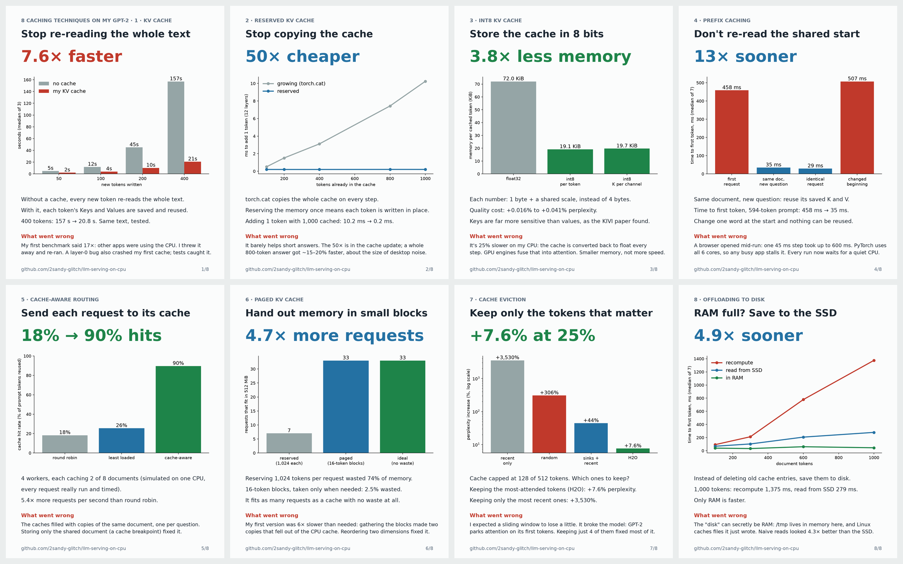

# LLM serving, rebuilt from scratch on a CPU

**I wrote GPT-2 from scratch in PyTorch, then rebuilt the caching tricks that make production LLM
servers fast (KV cache, paged attention, prefix caching, cache-aware routing, eviction, offloading)
and measured every one on a 6-core desktop CPU with no GPU.**


Every technique is built by hand, proven correct with tests, measured with a repeatable method, and
written up with what went wrong. No serving framework, no copied model code: just `torch` and
OpenAI's GPT-2 weights.



---

## The results

| # | Technique | The idea in one line | My result | What went wrong |
|---|---|---|---|---|
| 1 | [KV cache](gpt2-kv-cache/) | Save each token's Keys and Values instead of re-reading the whole text | **7.6× faster** at 400 tokens, identical text | First benchmark said 17×: other apps were using the CPU |
| 2 | [Reserved cache](gpt2-static-kv-cache/) | Take the memory once, write in place instead of `torch.cat` | Cache update **50× cheaper** at 1,000 tokens | Barely helps short answers: ~15–20% on whole runs |
| 3 | [int8 KV cache](gpt2-kv-cache-int8/) | Store K and V in 1 byte + a scale instead of 4 bytes | **3.8× less memory**, +0.016% perplexity | 25% slower on CPU: no fused kernel |
| 4 | [Prefix caching](gpt2-prefix-cache/) | Reuse the saved K and V of a shared document or system prompt | First token **13× sooner** (458 → 35 ms) | A browser opened mid-run and wrecked the timings |
| 5 | [Cache-aware routing](gpt2-cache-aware-routing/) | Send each request to the worker that already has its prefix | Cache hits **18% → 90%**, 5.4× throughput (simulated) | Caches filled with duplicate documents |
| 6 | [Paged KV cache](gpt2-paged-kv-cache/) | Hand out memory in 16-token blocks, as vLLM does | **4.7× more requests** in 512 MiB, 2.5% waste | Memory layout made my first version 6× slower |
| 7 | [Cache eviction](gpt2-kv-cache-eviction/) | Keep only the tokens that matter (H2O, attention sinks) | A quarter of the cache for **+7.6% perplexity** | A sliding window broke the model (+3,530%) |
| 8 | [Offloading to disk](gpt2-tiered-kv-cache/) | When RAM is full, save the cache to the SSD | **4.9× sooner** than recomputing at 1,000 tokens | The "disk" can secretly be RAM (tmpfs, page cache) |

Each folder has a README that explains the idea simply, shows the code, the tests, the method, the
results with ranges, the trade-offs, what didn't work, and ends with a self-check quiz.

## Why trust these numbers

**The model is right.** My GPT-2 matches Hugging Face's output within 1e-4 on every size I load
(distilgpt2, gpt2, gpt2-medium), and gets **exactly** the same perplexity on the whole WikiText-2
test set: 25.170 vs 25.170.

**Every cache keeps the output.** Where a technique shouldn't change the text, the tests check the
generated tokens are identical. Where it trades quality (int8, eviction), quality is measured
through the cache, one token at a time, not with a shortcut that skips it.

**The measurements are careful.**
- Warm-up runs are thrown away; 3–7 timed runs; median **and** min–max are reported.
- Settings take turns run by run, so a slow moment hits all of them.
- When whole runs are too noisy, the changed part is measured on its own.
- Runs start only when the CPU is quiet; disturbed runs are thrown away and the README says so.
- Every result folder has an `environment.json`: CPU, versions, threads, load at start and end.

## How it's built

```
llm-serving-on-cpu/
├── gpt2lab/                  the shared library, imported by every experiment
│   ├── model.py              GPT-2 from scratch (3 small hooks for a KV cache)
│   ├── load_weights.py       loads OpenAI's weights (distilgpt2 / gpt2 / gpt2-medium)
│   ├── kv_cache.py           1 growing KV cache        static_kv_cache.py    2 reserved
│   ├── int8_kv_cache.py      3 int8 K and V            prefix_cache.py       4 prefix caching
│   ├── routing.py            5 routing simulation      paged_kv_cache.py     6 paged blocks
│   ├── evicting_kv_cache.py  7 H2O / sinks / recent    tiered_prefix_store.py 8 RAM → disk
│   ├── bench.py              the shared benchmark method
│   └── perplexity.py         WikiText-2 quality score
├── tests/                    tests for the shared library
├── gpt2-<technique>/         one folder per experiment: tests/, benchmark/, results/, README.md
└── docs/                     images for this page
```

Every cache has the same small interface (`update`, `len`, `nbytes`), so the model doesn't care
which one it gets: swapping the growing cache for a paged or int8 one is one argument.

## Quick start

Needs [uv](https://docs.astral.sh/uv/) and Python 3.12. PyTorch installs CPU-only.

```bash
git clone https://github.com/2sandy-glitch/llm-serving-on-cpu.git && cd llm-serving-on-cpu
uv sync                                   # PyTorch (CPU) + the gpt2lab package
cd gpt2-prefix-cache && uv run pytest     # any experiment: its tests
uv run python benchmark/run.py            # ...and its benchmark (writes results/)
```

```python
from transformers import GPT2TokenizerFast
from gpt2lab.kv_cache import generate_with_cache
from gpt2lab.load_weights import load_gpt2
from gpt2lab.paged_kv_cache import BlockPool, PagedKVCache

tokenizer = GPT2TokenizerFast.from_pretrained("gpt2")
model = load_gpt2()                                     # my GPT-2, OpenAI's weights
idx = tokenizer("The cat sat on the", return_tensors="pt").input_ids
cache = PagedKVCache(BlockPool.for_model(model, num_blocks=64))
print(tokenizer.decode(generate_with_cache(model, idx, 30, cache=cache)[0]))
```

## What I learned

1. **Which tokens you keep matters more than how many.** Same cache budget: a sliding window lost
   +314% perplexity, H2O lost +1.4%. GPT-2 parks attention on its first tokens.
2. **Memory layout decides speed.** Reordering two tensor dimensions made the paged cache's gather
   6× faster, because the copies fit in the CPU's cache again.
3. **Most of serving is about memory, not maths.** int8, paging, eviction and offloading all trade
   a little speed or quality for fitting more users or longer texts.
4. **A cache is only useful if requests reach it.** The same caches gave 18% reuse with round robin
   and 90% with cache-aware routing.
5. **Benchmarks lie unless you check them.** A busy CPU, a RAM-backed `/tmp` and the OS page cache
   each produced impressive numbers that weren't real.

## What's next

The same GPT-2 at 16, 8 and 4 bits (weight quantization), then speculative decoding.

## Credits

Built on ideas from *Attention Is All You Need* (Vaswani et al.), GPT-2 (OpenAI), nanoGPT (Andrej
Karpathy), KIVI, SGLang (RadixAttention), vLLM (PagedAttention), H2O, StreamingLLM and LMCache.
Each experiment's README cites the papers it uses.

## Licence

MIT, see [LICENSE](LICENSE).
