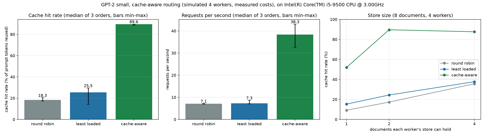

# GPT-2 cache-aware routing: send each request where its prefix is already cached

> Fifth experiment in the caching series. [Prefix caching](../gpt2-prefix-cache/) only helps if a
> request reaches a worker that already holds its shared start. With several workers, the router
> decides that. This experiment compares round robin, least loaded and a cache-aware router,
> using my own GPT-2 and measured costs.

**Result:** with 4 workers, 8 shared documents and 96 requests, the cache-aware router reused
**~90% of prompt tokens, against ~18% for round robin**, and finished the work **5.4× faster**
(38.3 vs 7.1 requests per second, median of 3 random orders). It did **5–6× less total
compute** (4.8–6.3× per order) for exactly the same requests.

**Important:** this is a **simulation on one CPU**, not a real cluster. Each request is really run
through the model on its chosen worker's prefix store, and the measured time is added to that
worker. The finish time assumes the workers would run in parallel.



---

## Contents
1. [The idea](#1-the-idea)
2. [What I built](#2-what-i-built)
3. [How I know it is correct](#3-how-i-know-it-is-correct)
4. [How I measured it](#4-how-i-measured-it)
5. [Results](#5-results)
6. [What I learned](#6-what-i-learned)
7. [Decisions and trade-offs](#7-decisions-and-trade-offs)
8. [Problems I hit and what didn't work](#8-problems-i-hit-and-what-didnt-work)
9. [Limits](#9-limits)
10. [Run it yourself](#10-run-it-yourself)
11. [Check yourself](#11-check-yourself)
12. [Reading and credits](#12-reading-and-credits)

---

## 1. The idea

A server runs several **workers** (copies of the model). Each keeps its own prefix cache in its own
memory. A **router** decides which worker gets each request.

```
                 ┌── worker 0: caches documents A, B
request (doc C) ─┼── worker 1: caches documents C, D   ← cache-aware sends it here
     router      ├── worker 2: caches documents E, F
                 └── worker 3: caches documents G, H
```

| Policy | How it picks | Problem |
|---|---|---|
| **Round robin** | Take turns: 0, 1, 2, 3, 0, … | Ignores the caches: every worker sees every document, and its small cache keeps losing them |
| **Least loaded** | The worker with the least work so far | Balances work, still ignores the caches |
| **Cache-aware** | The worker holding the longest prefix of this request, unless that worker is far busier than the rest; with no match, the least loaded | Must balance "reuse" against "spread the load" |

Everyday version: a hospital where each doctor has read some patients' files. Sending a returning
patient to a random doctor means re-reading the file; sending them to the doctor who already read
it saves that time, unless that doctor's queue is far too long.

## 2. What I built

```
llm-serving-on-cpu/
├── gpt2lab/routing.py           Worker, the 3 policies, simulate()   ← this experiment
├── gpt2lab/prefix_cache.py      + look-only lookup, + cache breakpoint (store only the document)
└── gpt2-cache-aware-routing/
    ├── tests/test_routing.py    7 tests
    ├── benchmark/run.py         3 policies x 3 random orders, and 3 store sizes
    └── results/                 results.csv, store_sizes.csv, environment.json, chart.png
```

- **`simulate(requests, policy, n_workers, store_size, run)`** gives each worker its own
  `PrefixStore` (least-recently-used, `store_size` documents). For each request it asks the policy
  for a worker, calls `run()` to really process the request on that worker's store, and adds the
  measured time to that worker.
- **`CacheAware`** checks every worker's store with a **look-only** lookup (it must not change which
  entry is least recently used), picks the longest match, and falls back to the least busy worker
  if the match's worker is more than 1 s busier, or if nothing matches.
- **Cache breakpoint:** each request stores only its **document**, not document + question. Without
  it, a worker's 2 slots would fill with copies of the same document followed by different
  questions. API prompt caching works the same way: you mark where the reusable part ends.

## 3. How I know it is correct

`uv run pytest` (from this folder) runs 7 tests:

| Test | What it proves |
|---|---|
| Round robin | Takes turns 0, 1, 2, 0, 1 |
| Least loaded | Picks the least busy worker |
| Cache-aware: longest match | Goes to the worker with the longest stored prefix |
| Cache-aware: balance | Falls back to the least busy worker when the match's worker is too busy, or nothing matches |
| Look-only lookup | The router's check doesn't change the stores' least-recently-used order |
| Cache breakpoint | Only the shared part is stored, and its memory is counted correctly |
| Simulation accounting | With fake costs: hit rate, total compute, finish time and balance are exact; round robin can get lucky with one order and lose everything with another |

The prefix-cache tests (same scores and text with and without reuse) still pass with the new
store features.

## 4. How I measured it

Intel i5-9500, 6 threads, float32. Details in [`results/environment.json`](results/environment.json).

- **Workload:** 8 documents (500 tokens each, from the WikiText-2 test set, 5,000 tokens apart) ×
  12 questions = **96 requests**, shuffled. Three random orders (seeds 0, 1, 2).
- **Workers:** 4, each with a prefix store holding **2 documents** (8 slots in total, for 8
  documents).
- **Costs:** every request is processed for real (prefill + first token) on its worker's store;
  the measured time is that request's cost.
- **Metrics:**
  - **cache hit rate** = prompt tokens reused ÷ prompt tokens;
  - **total compute** = all measured request times added up;
  - **finish time** = the busiest worker's total;
  - **requests per second** = 96 ÷ finish time;
  - **balance** = busiest worker ÷ average worker.
- Store-size sweep: 1, 2 and 4 documents per worker, one order.

## 5. Results

### Three policies (store holds 2 documents per worker; median of 3 orders, min–max)

| Policy | Cache hit rate | Total compute | Finish time | Requests per second |
|---|---|---|---|---|
| Round robin | 18.3% (17.3–20.4) | 52.0 s (47.3–53.2) | 13.5 s | 7.1 (6.9–7.2) |
| Least loaded | 25.5% (14.3–29.5) | 51.8 s (42.3–52.9) | 13.2 s | 7.3 (7.1–8.7) |
| **Cache-aware** | **89.6% (88.6–89.6)** | **8.4 s (8.4–10.9)** | **2.5 s** | **38.3 (32.6–43.1)** |

- Cache-aware is **5.4× faster** than round robin at the median (4.7–6.0× across the three orders).
- **89.6% is close to the best possible here.** Each of the 8 documents must be computed the first
  time it appears, and each prompt's question is always new, which caps the hit rate at about 90%.
- Balance stayed good (busiest worker 1.06–1.20× the average): cache-aware gave every worker
  ~24 requests, because each ended up "owning" 2 documents.

### Store size (one order)

| Documents per worker | Round robin | Least loaded | Cache-aware |
|---|---|---|---|
| 1 (4 slots for 8 documents) | 9.2% | 15.3% | 51.9% |
| 2 (8 slots) | 17.3% | 24.4% | 89.6% |
| 4 (16 slots) | 35.6% | 37.7% | 87.6% |

- When total cache space is smaller than the set of documents (1 per worker), even cache-aware
  routing must evict, but it still reuses 3–6× more than the others.
- Round robin needs **every** worker to hold **every** document to do well; cache-aware needs the
  documents to fit **once** across all workers. Doubling round robin's cache (2 → 4) only took it
  from 17% to 36%.
- Throughput for the sweep is a single run and noisier than the hit rate, so the chart shows hit
  rate; the numbers are in `store_sizes.csv`.

## 6. What I learned

1. **A cache is only useful if requests reach it.** Prefix caching on every worker still gave only
   ~18% reuse with round robin. Routing turned the same caches into ~90% reuse.
2. **Cache-aware routing turns many small caches into one big one.** Each worker effectively owns a
   subset of the documents, so the total cache space is used once instead of being filled with
   the same documents on every worker.
3. **Balance still matters.** Without the "too busy" fallback, a popular document would pile all
   its requests on one worker. Here the documents were equally popular, so the fallback rarely
   fired; skewed traffic would test it harder.
4. **Hit rate is the robust metric.** It depends on routing decisions, not timing noise.
   Throughput moved ±15% between orders on a desktop; the hit rate moved by 1 point.
5. **Least loaded is not cache-aware.** It balances work but reuses barely more than round robin.

## 7. Decisions and trade-offs

| Decision | Why | Cost |
|---|---|---|
| Simulation on one CPU with measured costs | No cluster needed; real model, real caches, real times | Ignores network, queueing delays and contention between real machines |
| All requests queued at the start | Simple throughput measure (finish time) | Doesn't model arrival times or per-request latency |
| Fallback when a match's worker is 1 s busier | Simple balance rule, like SGLang's balance threshold | The threshold is hand-picked |
| Router checks every worker's store | Exact; fine for 4 workers | Real routers keep an approximate copy of each worker's cache tree instead of asking |
| Cache breakpoint at the end of the document | Stores what is shared, not each question | The caller must know where the shared part ends |

## 8. Problems I hit and what didn't work

| Problem | What I saw | How I solved it |
|---|---|---|
| Stores filled with duplicates | Storing whole prompts meant "doc A + question 1" and "doc A + question 2" took both of a worker's slots | Added a cache breakpoint: store only the document part |
| Stored slices kept whole prompts alive | A slice of a tensor is a view, so storing the first 500 tokens kept all 510 in memory | Copy the slice when storing only part of a prompt, so the memory count is true |
| The router changed what it inspected | A normal lookup marks the entry "recently used", so just *checking* a worker reordered its cache | Added a look-only lookup for the router |
| Misleading chart | The store-size throughput line dipped at 4 documents, from timing noise in a single run | Plot hit rate (robust) for the sweep; keep throughput in the CSV |

## 9. Limits

- A simulation: one CPU, workers run one after another, costs measured per request.
- Documents are equally popular; real traffic is skewed (a few system prompts dominate).
- No arrival times or latency targets: throughput only.
- 96 requests, 8 documents, 4 workers: small, chosen to run in minutes on a desktop.

## 10. Run it yourself

From the repo root, once: `uv sync`. Then from this folder:

```bash
uv run pytest                                  # 7 tests
uv run python benchmark/run.py                 # ~5 minutes; writes results/
uv run python benchmark/run.py --chart-only    # redraw chart.png from the saved results
```

## 11. Check yourself

1. Why does round robin get so little reuse even though every worker has a prefix cache?
2. Why is ~90% the best possible hit rate in this workload?
3. Why does the router need a look-only lookup?
4. What does the "too busy" fallback protect against?
5. Why did doubling round robin's cache size help it so little?

<details><summary>Answers</summary>

1. Every worker sees every document in random order, and holds only 2 of the 8, so the document it
   needs has usually been evicted.
2. Each document must be computed the first time, and each question is always new.
3. Checking a store must not count as using an entry, or it would change what gets evicted.
4. A popular document piling all its requests onto one worker while others sit idle.
5. Round robin needs every worker to hold all 8 documents; 4 slots per worker is still only half.

</details>

## 12. Reading and credits

- Zheng et al., *"SGLang: Efficient Execution of Structured Language Model Programs"*, 2023,
  arXiv 2312.07104, and the SGLang v0.4 release notes on its cache-aware load balancer.
- Anthropic and OpenAI prompt caching documentation (cache breakpoints).
- Built on [prefix caching](../gpt2-prefix-cache/) and the shared [`gpt2lab`](../gpt2lab/) package.

## Licence
MIT, see [LICENSE](../LICENSE).
