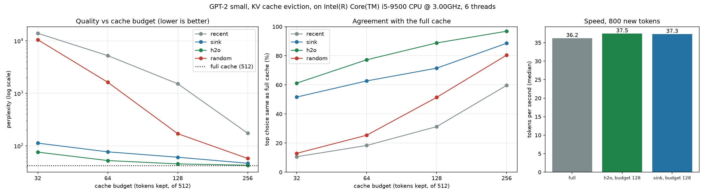

# GPT-2 KV cache eviction: keep the tokens that matter

> Seventh experiment in the caching series. Every cache so far keeps every token, so memory grows
> with the text. Here the cache has a **fixed budget**: when it is full, tokens are dropped. Which
> ones to drop decides everything. I compared four rules on my own GPT-2.

**Result:** keeping only **a quarter of the cache (128 of 512 tokens)**, H2O ("heavy hitters")
raised perplexity by just **+7.6%** and matched the full cache's top choice **89%** of the time.
At half the budget it cost **+1.4%**. A plain sliding window ("keep the most recent tokens") failed
badly even at half the budget (**+314%**), because it drops the first tokens, which GPT-2 uses as
**attention sinks**. Keeping just 4 of those first tokens fixed most of the damage (+314% → +10.7%).
Speed barely changes (~3% faster); the gain is memory: **9 MiB instead of 57 MiB** for an
800-token answer.



---

## Contents
1. [The idea](#1-the-idea)
2. [What I built](#2-what-i-built)
3. [How I know it is correct](#3-how-i-know-it-is-correct)
4. [How I measured it](#4-how-i-measured-it)
5. [Results](#5-results)
6. [What I learned](#6-what-i-learned)
7. [Decisions and trade-offs](#7-decisions-and-trade-offs)
8. [Problems I hit and what didn't work](#8-problems-i-hit-and-what-didnt-work)
9. [Limits](#9-limits)
10. [Run it yourself](#10-run-it-yourself)
11. [Check yourself](#11-check-yourself)
12. [Reading and credits](#12-reading-and-credits)

---

## 1. The idea

The other techniques in this series make the cache cheaper per token (int8), share it (prefix
caching) or pack it better (paging). They all still keep **every** token. For very long texts, the
cache can still outgrow memory. Eviction puts a hard limit on it: keep at most N tokens, drop the
rest. Dropping is lossy, so the only question is **which tokens to drop**.

| Rule | Keeps | Idea from |
|---|---|---|
| **Recent** (sliding window) | The last N tokens | The obvious first try |
| **Sink + recent** | The first 4 tokens + the most recent | StreamingLLM (Xiao et al. 2023): models dump lots of attention on the first tokens, "attention sinks"; losing them breaks the model |
| **H2O** (heavy hitters) | The tokens that have received the most attention so far + the most recent half of the budget | H2O (Zhang et al. 2023): a few tokens get most of the attention; keep those |
| **Random** | The newest token + random others | A control: any good rule must beat luck |

Everyday version: a notebook with a fixed number of pages. When it's full, which pages do you tear
out? Not the first page with the table of contents (the sink), and not the pages you keep looking
back at (the heavy hitters).

**A GPT-2 detail:** GPT-2 adds each token's position before computing K, so dropping tokens leaves
no gap to renumber. New tokens must keep counting positions from the number of tokens **seen**, not
the number **stored**.

## 2. What I built

```
llm-serving-on-cpu/
├── gpt2lab/evicting_kv_cache.py      EvictingKVCache: 5 policies   ← this experiment
├── gpt2lab/model.py                  + one optional hook: report attention weights to the cache
└── gpt2-kv-cache-eviction/
    ├── tests/test_evicting_kv_cache.py   14 tests
    ├── benchmark/run.py                  quality vs budget, speed
    └── results/                          quality.csv, speed.csv, environment.json, chart.png
```

- **`EvictingKVCache(n_layer, budget, policy)`** stores K and V like the growing cache, plus each
  stored token's **position** and its **attention received so far**. After each step, if a head
  holds more than `budget` tokens, every token gets a priority from the policy and the top `budget`
  stay. All five policies are the same code with a different priority:
  - recent: position;
  - sink: position, with the first 4 tokens forced to the top;
  - h2o: attention received, with the most recent half of the budget forced to the top;
  - random: random, with the newest token forced to the top;
  - full: never drop.
- **Each head chooses its own tokens**, as in H2O: one head may keep token 7 while another drops
  it. Every head keeps the same number, so K and V stay one tensor.
- **The one model change:** H2O needs to know how much attention each cached token got.
  `model.py` now calls `cache.observe(layer, weights)` after attention **if the cache has that
  method**. The other caches don't, so they behave exactly as before (their tests still pass).
- `len(cache)` returns tokens **seen**, so positions keep counting after tokens are dropped.

## 3. How I know it is correct

`uv run pytest` (from this folder) runs 14 tests:

| Test | What it proves |
|---|---|
| Budget bigger than the text (all 5 policies) | Nothing is dropped, and the text is identical to the normal cache |
| Budget respected, positions keep counting (4 policies) | Every layer stores exactly the budget; `len()` counts tokens seen; memory = budget × 73,728 bytes |
| Recent | Keeps the last N positions |
| Sink | Keeps the first tokens and the last ones |
| H2O | Keeps the tokens with the most attention plus the recent ones, and K moves with its token |
| Random | Keeps the newest token; the same seed gives the same choice |
| Heads choose their own tokens | Two heads with different favourites keep different tokens |

## 4. How I measured it

Intel i5-9500, 6 threads, float32. Details in [`results/environment.json`](results/environment.json).

1. **Quality vs budget.** 16 windows of 512 tokens from the WikiText-2 test set, fed **one token at
   a time** through each cache (teacher forcing), so eviction happens exactly as it would while
   generating. Budgets 256 / 128 / 64 / 32 tokens (50% to 6% of the window), four policies, plus
   the full cache, all side by side: 8,176 predictions each. Reported: perplexity, and how often
   the top choice matches the full cache's. (Quality doesn't depend on timing, so this part is
   unaffected by other programs.)
2. **Speed.** 800 new tokens: full cache vs H2O and sink with a 128-token budget; warm-up, 3 timed
   runs, median and min–max, taking turns. CPU load 2.04 at the start, no browser.

## 5. Results

### Quality vs cache budget (perplexity; full cache = 41.97)

| Budget (of 512) | Recent | Sink + recent | **H2O** | Random |
|---|---|---|---|---|
| 256 (50%) | 173.6 (+314%) | 46.5 (+10.7%) | **42.6 (+1.4%)** | 57.4 (+37%) |
| 128 (25%) | 1,523 (+3,530%) | 60.5 (+44%) | **45.2 (+7.6%)** | 170.2 (+306%) |
| 64 (12.5%) | 5,236 (+12,376%) | 76.7 (+83%) | **52.3 (+25%)** | 1,626 (+3,774%) |
| 32 (6%) | 13,967 (+33,179%) | 112.5 (+168%) | **75.7 (+80%)** | 10,520 (+24,966%) |

### Top choice same as the full cache

| Budget | Recent | Sink + recent | **H2O** | Random |
|---|---|---|---|---|
| 256 (50%) | 59.7% | 88.6% | **96.9%** | 80.4% |
| 128 (25%) | 31.3% | 71.5% | **88.8%** | 51.4% |
| 64 (12.5%) | 18.4% | 62.7% | **77.2%** | 25.4% |
| 32 (6%) | 10.6% | 51.6% | **61.2%** | 13.0% |

### Speed and memory (800 new tokens)

| Cache | Time, median (min–max) | Tokens per second | Cache at the end |
|---|---|---|---|
| Full | 22.10 s (21.59–22.38) | 36.2 | ~57 MiB (813 tokens) |
| H2O, 128 tokens | 21.36 s (21.29–21.53) | 37.5 | **9 MiB** |
| Sink, 128 tokens | 21.44 s (21.20–21.56) | 37.3 | **9 MiB** |

## 6. What I learned

1. **Which tokens you keep matters far more than how many.** At the same 50% budget, the recent
   window lost +314% and H2O lost +1.4%: over 200× more damage from the rule alone.
2. **Attention sinks are real in GPT-2.** Dropping the first tokens wrecked the model; keeping just
   4 of them turned +314% into +10.7%. That's StreamingLLM's finding, reproduced.
3. **Heavy hitters exist.** A small set of tokens gets most of the attention; keeping them (H2O)
   held quality best at every budget. It finds the sinks on its own, because they collect huge
   attention scores.
4. **Random beats the recent window at every budget.** Random keeps some early tokens by luck;
   the recent window never does. That's the sink effect again.
5. **Eviction is a memory tool, not a speed tool, at this size.** Attention over 128 instead of
   ~800 tokens saves time, but choosing what to drop costs time: net ~3% faster here. The win is a
   cache that never grows past its budget (9 MiB instead of 57 MiB).

## 7. Decisions and trade-offs

| Decision | Why | Cost |
|---|---|---|
| One optional `observe()` hook in `model.py` | H2O needs attention weights; other caches ignore it | The model changed for the first time in the series (one `if`) |
| Each head chooses its own tokens | As in H2O; heads attend to different things | Bookkeeping per head (scores and positions) |
| Recent half of the budget always kept (H2O) | The paper's default; the latest tokens matter for the next word | Fewer slots for heavy hitters |
| Accumulated (summed) attention | Simple, the paper's scoring | Favours older tokens, which have been looked at more often |
| Evict after every step | Memory never exceeds the budget | A ranking (`topk`) per layer per step |
| Built on the growing cache (`torch.cat`) | Simplest base for dropping entries | The copy cost of experiment 2 is back; a reserved buffer with slot reuse would avoid it |

## 8. Problems I hit and what didn't work

| Problem | What I saw | How I solved it |
|---|---|---|
| Positions after dropping tokens | With `len()` = tokens stored, new tokens would get the wrong position | `len()` returns tokens **seen**; stored count is separate |
| Model needed a new input | H2O's scores come from attention weights, which the cache never saw | One optional hook in `model.py`; all earlier caches' tests still pass |
| Speed run disturbed | Edge was open during the first run: H2O ranged 21.6–36.5 s | Kept the quality results (timing-independent), added `--speed-only`, re-ran with no browser: ranges within 1 s |
| Recent window "obviously fine" | I expected a sliding window to lose a little at 50% | It lost +314%. Investigating that led to the sink policy |

## 9. Limits

- GPT-2 small, 512-token windows, 8,176 predictions per setting.
- Perplexity and top-1 agreement only; no task-level tests (summaries, long-document questions).
- Learned absolute positions (GPT-2) make dropping easy; models with rotary positions (Llama) need
  more care when tokens are removed.
- Eviction runs on the growing cache, so it pays `torch.cat` copies; combining it with the reserved
  or paged cache is not done here.

## 10. Run it yourself

From the repo root, once: `uv sync`. Then from this folder:

```bash
uv run pytest                                  # 14 tests
uv run python benchmark/run.py                 # ~12 minutes; writes results/
uv run python benchmark/run.py --speed-only    # re-measure speed, keep quality.csv
uv run python benchmark/run.py --chart-only    # redraw chart.png
```

```python
from gpt2lab.evicting_kv_cache import EvictingKVCache
from gpt2lab.kv_cache import generate_with_cache

cache = EvictingKVCache(model.config.n_layer, budget=128, policy="h2o")
out = generate_with_cache(model, idx, 800, cache=cache)   # the cache never holds more than 128 tokens
```

## 11. Check yourself

1. Why did the sliding window fail so badly, even at half the budget?
2. What is an attention sink?
3. How does H2O decide what to keep, and why does it keep the sinks without being told?
4. Why must `len(cache)` count tokens seen, not tokens stored?
5. Why is eviction barely faster here, if attention reads 6× fewer tokens?

<details><summary>Answers</summary>

1. It drops the first tokens, which receive a large share of attention (the sinks); without them
   the attention has nowhere to "rest" and the model's outputs break.
2. A token (usually the first few) that many heads attend to heavily regardless of meaning, as a
   default place to put attention.
3. By the attention each token has received so far, plus the most recent tokens. The sinks receive
   the most attention, so they score highest.
4. GPT-2 gives each new token the position after the last one seen; counting stored tokens would
   reuse old positions after a drop.
5. Choosing what to drop (ranking every stored token in every layer, every step) costs time too,
   and the base cache still copies with `torch.cat`.

</details>

## 12. Reading and credits

- Zhang et al., *"H2O: Heavy-Hitter Oracle for Efficient Generative Inference of Large Language
  Models"*, NeurIPS 2023, arXiv 2306.14048.
- Xiao et al., *"Efficient Streaming Language Models with Attention Sinks"* (StreamingLLM), ICLR
  2024, arXiv 2309.17453.
- Built on the [growing KV cache](../gpt2-kv-cache/) and the shared [`gpt2lab`](../gpt2lab/) package.

## Licence
MIT, see [LICENSE](../LICENSE).
