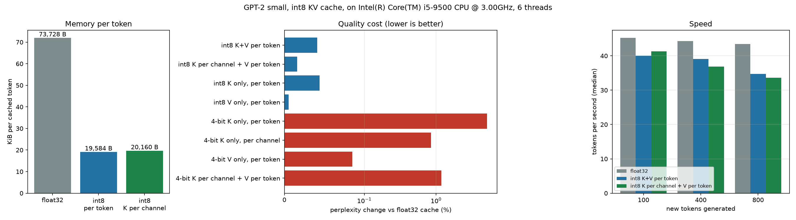

# GPT-2 int8 KV cache: a quarter of the memory, almost no quality cost

> Third experiment in the caching series. The [first cache](../gpt2-kv-cache/) stores every Key and
> Value as a 32-bit float; the [reserved cache](../gpt2-static-kv-cache/) stopped copying them. This
> one stores them as **8-bit integers with scales**, and measures what that costs in quality and
> speed.

**Result:** the cache shrank from **73,728 to 19,584 bytes per token (3.8× less)**. Perplexity
through the cache rose by only **0.04%**, or **0.016%** with per-channel key scales (the KIVI recipe), and
greedy text stayed identical for 200 tokens on 8 of 8 prompts with per-channel keys. On this CPU
it is **slower** (800 tokens take 25% longer), because every step converts the cache back to
float. I also reproduced the KIVI finding that **keys are far more sensitive to rounding than
values**.



---

## Contents
1. [The idea](#1-the-idea)
2. [Which numbers share a scale](#2-which-numbers-share-a-scale)
3. [What I built](#3-what-i-built)
4. [How I know it is correct](#4-how-i-know-it-is-correct)
5. [How I measured it](#5-how-i-measured-it)
6. [Results](#6-results)
7. [What I learned](#7-what-i-learned)
8. [Decisions and trade-offs](#8-decisions-and-trade-offs)
9. [Problems I hit and what didn't work](#9-problems-i-hit-and-what-didnt-work)
10. [Limits](#10-limits)
11. [Run it yourself](#11-run-it-yourself)
12. [Check yourself](#12-check-yourself)
13. [Reading and credits](#13-reading-and-credits)

---

## 1. The idea

Each cached token keeps 2 × 12 layers × 12 heads × 64 = **18,432 numbers**. In float32 that is
4 bytes each: **73,728 bytes per token**. A 1,000-token conversation is 72 MB for one user.

int8 stores each number as a whole number from −127 to 127 (1 byte), plus a float **scale** shared
by a group of numbers:

```
original:   0.40   -1.20    2.54    0.05
scale     = biggest size / 127 = 2.54 / 127 = 0.02
stored:      20     -60     127      3        (round(x / scale), 1 byte each)
read back:  0.40   -1.20    2.54    0.06      (int8 × scale; 0.05 became 0.06)
```

The rounding error is at most half a step (scale / 2). That error is the cost; 4× less memory is
the gain.

## 2. Which numbers share a scale

| Mode | Shared by | Good for | Catch |
|---|---|---|---|
| **Per token** | The 64 numbers of one token in one head | Streaming: each token is quantized the moment it arrives | One huge number stretches the scale for all 64 |
| **Per channel** | One of the 64 positions, across a group of 32 tokens | Keys, which have a few "outlier" channels that are always large | The newest tokens must wait in float32 until a group of 32 is full |

Why keys and values differ (the KIVI finding): keys have a few channels with consistently large
numbers. With a per-token scale, those channels force a big scale, and the small channels lose
precision:

```
key numbers:   40.0   0.9   1.1   0.3      per-token scale = 40 / 127 = 0.315
read back:     40.0   0.94  0.94  0.31     (1.1 became 0.94)
```

Per channel, the big channel gets its own big scale and the small ones keep small scales. Values
don't have this pattern, so per token suits them.

## 3. What I built

```
llm-serving-on-cpu/
├── gpt2lab/int8_kv_cache.py       quantize(), dequantize(), QuantizedKVCache   ← this experiment
└── gpt2-kv-cache-int8/
    ├── tests/test_int8_kv_cache.py   14 tests
    ├── benchmark/run.py              memory, quality through the cache, greedy text, speed
    └── results/                      quality.csv, greedy.csv, speed.csv, environment.json, chart.png
```

- `QuantizedKVCache` reserves memory once (like the reserved cache) as int8 tensors plus float32
  scales. K and V each pick a mode: `per_token`, `per_channel` or `none` (float32).
- `update()` quantizes the new tokens, stores them, and returns **float** K and V for all tokens,
  because the model's attention is ordinary float maths. `model.py` is unchanged: same interface
  as the other caches.
- Per-channel keys keep a small float32 **residual** buffer for the newest (fewer than 32) tokens.
  When it fills, the group is quantized and moved into int8 storage.
- `bits=4` is accepted for sensitivity experiments, but values are still stored one per byte (not
  packed), so 4-bit rows save no extra memory here.

Memory per token, from the formula and checked in the tests:

| Setting | Numbers | Scales | Total | vs float32 |
|---|---|---|---|---|
| float32 | 18,432 × 4 B | – | 73,728 B | 1× |
| int8, K and V per token | 18,432 × 1 B | 2 × 12 × 12 × 4 B = 1,152 B | **19,584 B** | 3.76× less |
| int8, K per channel, V per token | 18,432 B | 1,152 B (K) + 576 B (V) | **20,160 B** | 3.66× less |

## 4. How I know it is correct

`uv run pytest` (from this folder) runs 14 tests:

| Test | What it proves |
|---|---|
| Round-trip error (8 and 4 bits, per token and per channel, with an outlier channel) | Every value comes back within half a step of the original |
| Bytes per token | 19,584 and 20,160 as in the table; 73,728 with quantization off; per sequence whatever the batch size |
| Quantization off | Exactly the reserved cache's tokens |
| Same short text (3 prompts × 2 key modes) | int8 writes the same 30 greedy tokens as the float cache |
| Per-channel bookkeeping | Full groups quantized, the rest exact in float32, every token read back in order |
| Full cache | A clear error past `max_tokens` |

The benchmark also checks its own method: the float32 cache's perplexity, fed one token at a time,
must equal the no-cache perplexity on the same text. It did: **37.749 both ways**.

## 5. How I measured it

Intel i5-9500, 6 threads, PyTorch 2.15 (CPU), CPU load 0.55 at the start. Details in
[`results/environment.json`](results/environment.json).

1. **Quality through the cache.** The shared perplexity script reads whole windows without a cache,
   so it can't see rounding inside the cache. Instead: 32 windows of 512 tokens from the WikiText-2
   test set, fed **one token at a time through each cache** (teacher forcing: always the real next
   token). That's 16,352 predictions per setting, each compared with the float32 cache at the same
   position: perplexity, how often the top choice is the same, and how far the scores move.
2. **Greedy text.** 8 varied prompts × 200 new tokens: is the text identical to the float32
   cache's, and if not, where does it first differ?
3. **Speed.** 100 / 400 / 800 new tokens, 1 warm-up, 3 timed runs, median and min–max; the
   settings take turns run by run.

## 6. Results

### Quality through the cache (16,352 predictions per setting)

| Setting | Perplexity | Change | Top choice same as float32 | Mean score change |
|---|---|---|---|---|
| float32 cache | 37.749 | – | 100% | 0 |
| **int8, K and V per token** | 37.764 | **+0.041%** | 99.26% | 0.345 |
| **int8, K per channel + V per token** | 37.755 | **+0.016%** | 99.55% | 0.219 |
| int8, K only (per token) | 37.765 | +0.044% | 99.30% | 0.311 |
| int8, V only (per token) | 37.751 | +0.005% | 99.67% | 0.144 |
| 4-bit, K only, per token | 39.677 | **+5.109%** | 86.52% | 7.09 |
| 4-bit, K only, per channel | 38.068 | +0.846% | 94.30% | 2.73 |
| 4-bit, V only, per token | 37.781 | +0.085% | 93.87% | 2.65 |
| 4-bit, K per channel + V per token | 38.195 | +1.184% | 91.55% | 3.82 |

Why 37.7 and not the 25.17 baseline: these windows don't overlap, so the first tokens of each
window have almost no context. The number is for comparing settings on the same text, not with
the baseline.

### Greedy text (8 prompts × 200 tokens)

| Setting | Identical for all 200 tokens |
|---|---|
| int8, K and V per token | 7 of 8 (one prompt first differed at token 72) |
| int8, K per channel + V per token | **8 of 8** |
| int8, K only | 8 of 8 |
| int8, V only | 8 of 8 |

### Speed (median of 3 runs, min–max)

| New tokens | float32 cache | int8 per token | int8 K per channel |
|---|---|---|---|
| 100 | 2.21 s (2.10–2.34) | 2.50 s (2.32–2.61) | 2.42 s (2.40–2.61) |
| 400 | 9.02 s (8.91–9.08) | 10.23 s (10.19–10.52) | 10.85 s (10.74–10.87) |
| 800 | **18.43 s** (18.31–18.61) | **23.05 s** (22.92–23.10) | **23.76 s** (23.65–23.94) |

The ranges don't overlap: **at 800 tokens int8 takes 25–29% longer** (tokens/s down 20–22%) on this CPU.

## 7. What I learned

1. **int8 KV is nearly free in quality.** +0.016% to +0.04% perplexity for 3.8× less memory.
2. **Keys are much more sensitive than values.** At int8, rounding only K cost 9× more perplexity
   than rounding only V (+0.044% vs +0.005%); at 4 bits, 60× more (+5.1% vs +0.085%). This is
   KIVI's finding, reproduced on GPT-2.
3. **Per-channel scales rescue keys.** At 4 bits, switching keys from per token to per channel cut
   the damage 6× (+5.1% → +0.85%). At int8 it cut the remaining error 2.5× (+0.041% → +0.016%) and kept all
   8 greedy texts identical.
4. **Smaller isn't faster here.** Each step converts the whole cache back to float before attention,
   an extra pass over memory that grows with the text. Engines like vLLM fuse that conversion
   into the attention kernel on GPUs; my plain PyTorch can't. int8 buys **capacity** (more users,
   longer contexts), not speed, in this setup.
5. **Top-1 agreement and perplexity tell different stories.** 4-bit values changed the top choice
   in 6% of positions but moved perplexity only 0.085%: the swaps were between near-equal choices.

## 8. Decisions and trade-offs

| Decision | Why | Cost |
|---|---|---|
| Symmetric quantization (no zero point) | Simple; K and V are centred around zero | Slightly less precise for lopsided ranges |
| Built on the reserved cache | No copying (experiment 2) and fixed memory | Memory reserved up front |
| Return float K and V | The model's attention stays unchanged | Dequantizing every step costs time (see speed) |
| Group of 32 tokens for per-channel keys | Small enough for a small float residual, large enough to share scales | Up to 31 tokens kept in float32 per layer |
| 4-bit stored unpacked | Enough to test sensitivity | No extra memory saving for 4-bit here |

## 9. Problems I hit and what didn't work

| Problem | What I saw | How I solved it |
|---|---|---|
| Measuring quality *through* the cache | The shared perplexity script never uses a cache, so int8 would look perfect | Teacher-forced decoding one token at a time, batched (32 windows) to keep it to minutes |
| Proving the new method | A new evaluation could hide its own bug | Check built in: float32 through the cache must equal no-cache perplexity (37.749 = 37.749) |
| Bytes per token 32× too high | The first results showed 626,688 B for int8 | `bytes_per_token()` didn't divide by the batch size (32 windows). Fixed it, added a test, recomputed the column; the measurements were unaffected |
| "Largest score change" misleading | Max differences of 25–74 points for int8, from a few extreme positions among 16,352 × 50,257 scores | Report the mean change and the top-choice agreement instead; the max stays in `quality.csv` |
| Speed | Hoped for at least no slowdown | It takes 25–29% longer on CPU; reported as a finding, not hidden |

## 10. Limits

- One model (GPT-2 small, 124M), one CPU, 16,352 predictions for quality.
- Dequantization is plain PyTorch, not a fused kernel, so the speed result says nothing about GPUs.
- **Possible follow-up for the slowdown:** fold the scales into the attention maths
  (`q · (int8 × scale) = (q · int8) × scale`, so the small score matrix is scaled instead of the
  whole cache), and compare with llama.cpp's quantized KV cache, which uses fused CPU kernels.
- 4-bit rows are for quality only (not packed).
- No outlier handling beyond per-channel scales (KIVI also keeps a window of recent tokens in full
  precision; mine keeps only the incomplete group).

## 11. Run it yourself

From the repo root, once: `uv sync`. Then from this folder:

```bash
uv run pytest                                  # 14 tests
uv run python benchmark/run.py                 # ~20 minutes; writes results/
uv run python benchmark/run.py --chart-only    # redraw chart.png from the saved results
```

```python
from gpt2lab.int8_kv_cache import QuantizedKVCache
from gpt2lab.kv_cache import generate_with_cache

cache = QuantizedKVCache.for_model(model, key_mode="per_channel", value_mode="per_token")
out = generate_with_cache(model, idx, 100, cache=cache)
```

## 12. Check yourself

1. How many bytes per token does the int8 cache use, and where do the extra 1,152 bytes come from?
2. Why does one large number hurt a per-token scale?
3. Which is more sensitive to rounding, keys or values, and what fixes keys?
4. Why is the int8 cache slower here, and why isn't it slower in vLLM on a GPU?
5. Why can't the normal perplexity script measure the int8 cache?

<details><summary>Answers</summary>

1. 19,584: 18,432 one-byte numbers plus 1,152 bytes of float32 scales (one per token, per head,
   per layer, for K and V).
2. The scale is set by the largest number, so the step size becomes big and the small numbers
   round coarsely.
3. Keys (9× at int8, 60× at 4 bits). Per-channel scales for keys.
4. Each step converts the whole cache back to float in a separate pass. vLLM fuses that
   conversion into the attention kernel.
5. It reads whole windows without a cache, so cache rounding never happens. You must decode one
   token at a time through the cache.

</details>

## 13. Reading and credits

- Liu et al., *"KIVI: A Tuning-Free Asymmetric 2bit Quantization for KV Cache"*, 2024, arXiv
  2402.02750: keys per channel, values per token.
- Hooper et al., *"KVQuant: Towards 10 Million Context Length LLM Inference with KV Cache
  Quantization"*, 2024, arXiv 2401.18079.
- vLLM documentation, "Quantized KV Cache" (FP8 KV cache).
- Built on the [reserved cache](../gpt2-static-kv-cache/) and the shared [`gpt2lab`](../gpt2lab/) package.

## Licence
MIT, see [LICENSE](../LICENSE).
