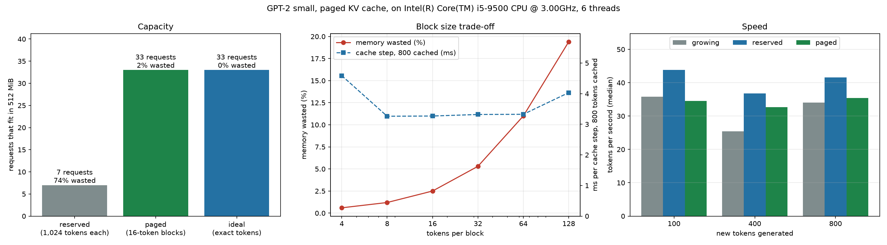

# GPT-2 paged KV cache: memory in small blocks, handed out as needed

> Sixth experiment in the caching series. The [reserved cache](../gpt2-static-kv-cache/) stopped
> copying by taking room for the longest possible text up front: 72 MiB per request, even for a
> 20-token answer. With many users that wastes most of the memory. Paging (vLLM's PagedAttention
> idea) hands out small blocks only when a request needs them.

**Result:** in a 512 MiB cache budget, with 200 realistic requests (median 207 tokens), the
reserved cache fit **7 requests and wasted 74%** of its memory. The paged cache fit **33 requests
(4.7×) and wasted 2.5%**, as many as a perfect no-waste cache. The price is speed: gathering the
blocks back into order costs time, and a whole 800-token answer took **22.6 s instead of 19.3 s**
(17% slower than the reserved cache, about the same as the growing one). On the way I found
and fixed a **memory-layout problem that made the gather 6× slower** than it needed to be.



---

## Contents
1. [The idea](#1-the-idea)
2. [What I built](#2-what-i-built)
3. [How I know it is correct](#3-how-i-know-it-is-correct)
4. [How I measured it](#4-how-i-measured-it)
5. [Results](#5-results)
6. [What I learned](#6-what-i-learned)
7. [Decisions and trade-offs](#7-decisions-and-trade-offs)
8. [Problems I hit and what didn't work](#8-problems-i-hit-and-what-didnt-work)
9. [Limits](#9-limits)
10. [Run it yourself](#10-run-it-yourself)
11. [Check yourself](#11-check-yourself)
12. [Reading and credits](#12-reading-and-credits)

---

## 1. The idea

A server doesn't know how long an answer will be. The reserved cache plays safe and takes room for
the maximum, 1,024 tokens, for every request. Most requests are much shorter, so most of that room
stays empty.

Paging works like an operating system's memory:

```
shared pool:   [b0][b1][b2][b3][b4][b5][b6][b7] ...   blocks of 16 tokens, reserved once for the server

request A (40 tokens):  block table [b0, b3, b4]      3 blocks, the last one half full
request B (20 tokens):  block table [b1, b2]
free:                   [b5, b6, b7, ...]
```

- Each request has a **block table**: which pool blocks hold its tokens, in order. Its blocks can
  be anywhere in the pool.
- A new block is taken only when the request's last block is full.
- When a request ends, its blocks go back to the pool for the next one.

A request wastes at most one partly filled block. The catch: to run attention, the request's
blocks must be read back in token order. vLLM's GPU kernel reads them directly; plain PyTorch has
to **gather** them into one tensor first, which costs time.

Everyday version: a library that hands out notebook pages one at a time and keeps an index of whose
pages are where, instead of giving every visitor a 1,024-page notebook at the door.

## 2. What I built

```
llm-serving-on-cpu/
├── gpt2lab/paged_kv_cache.py      BlockPool + PagedKVCache   ← this experiment
└── gpt2-paged-kv-cache/
    ├── tests/test_paged_kv_cache.py   13 tests
    ├── benchmark/run.py               capacity, block sizes, cache step, speed
    └── results/                       capacity.csv, block_sizes.csv, cache_step.csv, speed.csv, environment.json, chart.png
```

- **`BlockPool`** holds all K and V memory as fixed-size blocks, shape
  `(layers, heads, blocks, block_size, head_dim)`, with a free list. `allocate()` and `release()`
  hand blocks out and take them back.
- **`PagedKVCache`** is one request's view: its block table and write position. `update()` takes
  a new block when needed (once per step, at layer 0, since all layers share the table), writes the
  new tokens into place, and gathers the request's blocks back into token order. `free()` returns
  its blocks to the pool.
- Same interface as the other caches, so `model.py` is unchanged.

## 3. How I know it is correct

`uv run pytest` (from this folder) runs 13 tests:

| Test | What it proves |
|---|---|
| Same text (3 prompts × block sizes 1, 16, 64) | Same 40 tokens as the growing cache |
| Blocks taken only when needed and returned | 16 tokens = 1 block; token 17 takes a second; `free()` empties the pool |
| Two requests sharing one pool | Decoded in turns, each gets exactly its solo text, and they never hold the same block |
| Freed blocks are reused | A new request gets the blocks the last one gave back |
| Full pool | A clear error when no blocks are left |

The benchmark also checks that the growing, reserved and paged caches write the same text at every
length.

## 4. How I measured it

Intel i5-9500, 6 threads, float32, CPU load 2.28 at the start, no browser running. Details in
[`results/environment.json`](results/environment.json).

1. **Capacity.** 200 request lengths (prompt + answer) drawn from a log-normal distribution:
   median 207 tokens, longest 992, 53,309 tokens in total, so most requests are short and a few are long, like
   real traffic. With a **512 MiB** budget:
   - reserved: every request takes 1,024 tokens of room (72 MiB);
   - paged: requests are **really allocated** in a pool of that size, in order, until it is full;
   - ideal: exactly the tokens needed, no waste (a lower bound).

   Memory waste = reserved but unused ÷ reserved, over all 200 requests. (Memory doesn't depend on
   the numbers stored, so this part uses dummy K and V.)
2. **Block size** 4 to 128 tokens: waste, requests that fit, and the **cache step alone**: write
   1 token into all 12 layers and gather everything back, with 100 / 400 / 800 tokens cached
   (median of 15 × 20 steps; no model, so other programs disturb it far less).
3. **Speed** with the real model: growing vs reserved vs paged (16-token blocks) at 100 / 400 / 800
   new tokens; warm-up, 3 timed runs, median and min–max, taking turns.

## 5. Results

### Capacity (512 MiB, 200 requests)

| Scheme | Requests that fit | Memory wasted |
|---|---|---|
| Reserved (1,024 tokens each) | 7 | **74.0%** |
| **Paged (16-token blocks)** | **33 (4.7×)** | **2.5%** |
| Ideal (exact tokens) | 33 | 0% |

### Block size

| Tokens per block | Memory wasted | Requests that fit | Cache step, 800 cached |
|---|---|---|---|
| 4 | 0.6% | 33 | 4.59 ms |
| 8 | 1.2% | 33 | 3.26 ms |
| **16** | **2.5%** | **33** | **3.27 ms** |
| 32 | 5.3% | 31 | 3.32 ms |
| 64 | 11.0% | 28 | 3.33 ms |
| 128 | 19.4% | 24 | 4.03 ms |

Small blocks waste less (only the last block of each request is partly empty) but mean more pieces
to look up; big blocks waste more. 8–16 tokens is the sweet spot here; vLLM's default is 16.

### The cache step (write 1 token + get all K and V back, 12 layers)

| Tokens cached | Reserved | Paged, 16-token blocks |
|---|---|---|
| 100 | 0.20 ms | 0.91 ms |
| 400 | 0.20 ms | 1.76 ms |
| 800 | 0.20 ms | 3.27 ms |

The reserved cache returns a view of memory that is already in order, so its step costs the same at
any length. Paging must gather, and the gather grows with the text.

### Whole generation (median of 3, min–max)

| New tokens | Growing | Reserved | Paged |
|---|---|---|---|
| 100 | 2.80 s (2.30–2.99) | 2.28 s (2.21–2.50) | 2.90 s (2.34–4.70) |
| 400 | 15.71 s (10.84–18.03) | 10.86 s (9.60–11.72) | 12.23 s (11.19–17.31) |
| 800 | 23.47 s (23.13–25.07) | **19.25 s** (19.03–19.25) | **22.62 s** (22.55–23.88) |

At 800 tokens the ranges don't overlap: paged is about **17% slower than reserved**; against growing
the ranges touch, so call it about the same. At 100–400 tokens the spreads are too wide to separate them.

## 6. What I learned

1. **Paging is a memory feature, not a speed feature.** It fits 4.7× more requests in the same
   memory, as many as a no-waste cache, and pays for it with a gather on every step.
2. **Reserving for the worst case wastes most of the memory.** With realistic lengths, 74% of the
   reserved cache was empty.
3. **Memory layout decides speed.** The same gather was 6× slower with one layout than another,
   just from the order of two dimensions (see Problems).
4. **Block size is a trade-off with a flat middle.** 8–16 tokens wastes under 3% with no speed cost.
5. **Kernels matter.** vLLM reads blocks inside its attention kernel instead of gathering. My plain
   PyTorch version shows why that kernel exists.

## 7. Decisions and trade-offs

| Decision | Why | Cost |
|---|---|---|
| Gather blocks into one tensor, then normal attention | Keeps `model.py` unchanged | One copy of the request's K and V every step |
| Pool layout heads-first: `(layers, heads, blocks, block_size, dim)` | The gather comes out already in order: one copy | Writes touch every head's slice (cheap: 1 token) |
| One block table shared by all layers, extended at layer 0 | Every layer has the same tokens; one allocation per step | Layer 0 must run first (it always does) |
| 16-token blocks | Under 3% waste, no measurable speed cost here; vLLM's default | – |
| Batch size 1 per paged cache | Each request has its own block table | Requests can't be batched in one forward pass here |

## 8. Problems I hit and what didn't work

| Problem | What I saw | How I solved it |
|---|---|---|
| A browser ruined the first run | Block-size speeds jumped around (4-token blocks "fastest"); 100-token runs ranged 3.1–8.7 s | Edge had started mid-run. Replaced the block-size speed test with the cache-step micro-benchmark, and re-ran with no browser |
| A 10× cliff in the cache step | 2.1 ms at 400 tokens cached, then **20.7 ms at 800** | With blocks-first layout, the gather made two full copies per layer: collect the blocks, then reorder the heads (`permute` + `reshape`). At 800 tokens that's ~10 MB per layer, more than the CPU's 9 MB L3 cache. Switching the pool to heads-first made the gathered blocks come out in order: one copy. Cache step at 800 cached: **20.7 → 3.3 ms (6.3×)**; whole 800-token answer: 25.5 → 22.6 s |
| Checking the fix fairly | A first quick check after the tests looked mixed | Timed both layouts side by side, taking turns: heads-first was faster at every size (0.51 vs 1.07 ms, 9.3 vs 10.4 ms, 19.0 vs 23.9 ms on a busy CPU) |
| Noisy whole runs at 100–400 tokens | Spreads up to 2× | Reported with min–max; the 800-token result and the cache-step numbers carry the conclusion |

## 9. Limits

- The gather is a separate copy every step; a real paged-attention kernel avoids it.
- One request per forward pass: the pool is shared, but requests aren't batched together.
- Capacity counts the cache only, not the model's own memory.
- Request lengths are synthetic (log-normal), not from real traffic.
- No sharing of blocks between requests with the same prefix (vLLM does this with reference
  counts; my [prefix cache](../gpt2-prefix-cache/) keeps whole copies instead).

## 10. Run it yourself

From the repo root, once: `uv sync`. Then from this folder:

```bash
uv run pytest                                  # 13 tests
uv run python benchmark/run.py                 # ~10 minutes; writes results/
uv run python benchmark/run.py --chart-only    # redraw chart.png from the saved results
```

```python
from gpt2lab.kv_cache import generate_with_cache
from gpt2lab.paged_kv_cache import BlockPool, PagedKVCache

pool = BlockPool.for_model(model, num_blocks=455, block_size=16)   # 512 MiB for GPT-2 small
cache = PagedKVCache(pool)
out = generate_with_cache(model, idx, 100, cache=cache)
cache.free()                                                        # blocks back to the pool
```

## 11. Check yourself

1. Why did the reserved cache waste 74% of its memory?
2. What is a block table, and why can a request's blocks sit anywhere in the pool?
3. At most how much memory does one paged request waste?
4. Why is the paged cache slower than the reserved one here, and how does vLLM avoid that?
5. Why did changing the order of two dimensions make the gather 6× faster?

<details><summary>Answers</summary>

1. It reserves 1,024 tokens for every request, but the median request uses 207.
2. The list of pool blocks holding the request's tokens, in order. Order comes from the table, so
   the blocks themselves can be anywhere.
3. One partly filled block: up to 15 tokens' worth with 16-token blocks.
4. It gathers the request's blocks into one tensor every step. vLLM's attention kernel reads the
   blocks in place.
5. With heads first, the gathered blocks are already in the order attention needs, so one copy is
   enough. With blocks first, a second full copy was needed to move the heads to the front, and at
   800 tokens the two copies no longer fit in the CPU's fast cache.

</details>

## 12. Reading and credits

- Kwon et al., *"Efficient Memory Management for Large Language Model Serving with
  PagedAttention"*, SOSP 2023, arXiv 2309.06180 (vLLM).
- vLLM documentation, "Paged Attention" design notes.
- Built on the [reserved cache](../gpt2-static-kv-cache/) and the shared [`gpt2lab`](../gpt2lab/) package.

## Licence
MIT, see [LICENSE](../LICENSE).
