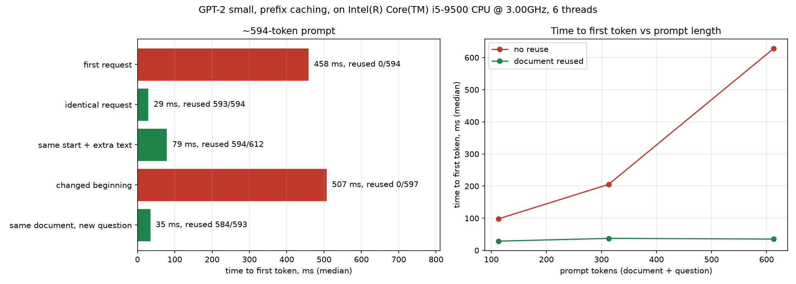

# GPT-2 prefix caching: don't re-read what you've already read

> Fourth experiment in the caching series. A KV cache saves work **within** one request. Prefix
> caching saves work **across** requests: when a new prompt starts with text the model has already
> processed (a system prompt, a shared document), it reuses that text's saved Keys and Values and
> computes only the new part.

**Result:** for a ~600-token prompt (a document plus a question), time to first token dropped from
**458 ms to 35 ms (13× faster)** when only the question changed, and to **29 ms (16×)** for an
identical request, with exactly the same output. The gain grows with the shared part: 3.4× at
100 tokens, 5.5× at 300, **17.8× at 600**. The cost: **41.8 MiB of memory** to keep one
594-token prompt.



---

## Contents
1. [The idea](#1-the-idea)
2. [What I built](#2-what-i-built)
3. [How I know it is correct](#3-how-i-know-it-is-correct)
4. [How I measured it](#4-how-i-measured-it)
5. [Results](#5-results)
6. [What I learned](#6-what-i-learned)
7. [Decisions and trade-offs](#7-decisions-and-trade-offs)
8. [Problems I hit and what didn't work](#8-problems-i-hit-and-what-didnt-work)
9. [Limits](#9-limits)
10. [Run it yourself](#10-run-it-yourself)
11. [Check yourself](#11-check-yourself)
12. [Reading and credits](#12-reading-and-credits)

---

## 1. The idea

Before a model writes anything, it must read the whole prompt and compute K and V for every token
(the **prefill**). For long prompts that is the slow part, and it decides the **time to first
token**, the wait before an answer starts.

Many requests share their start:

```
request 1:  [ document, 580 tokens ] + "Summarise the passage."
request 2:  [ same document        ] + "What is the main subject?"
```

A token's K and V depend only on the tokens before it, so the document's K and V are **identical**
in both requests. Prefix caching keeps them after request 1 and loads them for request 2:

```
request 2:  [ document: loaded from the store ] + [ question: computed now ]
```

Everyday version: a teacher who has already read the textbook only needs to read the new question.

Two rules decide what can be reused:
- **Only a shared start counts.** Change the first token and every K and V after it changes too,
  so nothing can be reused.
- **The last prompt token is always computed,** even for an identical prompt: its scores pick the
  first new token, and scores aren't stored.

## 2. What I built

```
llm-serving-on-cpu/
├── gpt2lab/prefix_cache.py      PrefixStore + prefill_with_prefix_cache()   ← this experiment
└── gpt2-prefix-cache/
    ├── tests/test_prefix_cache.py   6 tests
    ├── benchmark/run.py             time to first token: 5 cases, and 3 prompt lengths
    └── results/                     cases.csv, lengths.csv, environment.json, chart.png
```

- **`PrefixStore`** keeps the K and V of earlier prompts, keyed by their token ids. It holds a
  limited number (default 8) and drops the **least recently used** first.
- **`prefill_with_prefix_cache(model, prompt, store)`**:
  1. finds the stored prompt sharing the **longest token prefix** with the new one;
  2. loads that many tokens' K and V into a fresh cache by calling the cache's own `update()`, so
     it works with any of my caches;
  3. runs the model only on the remaining tokens;
  4. saves the new prompt in the store.

`model.py` is unchanged.

## 3. How I know it is correct

`uv run pytest` (from this folder) runs 6 tests:

| Test | What it proves |
|---|---|
| Five cases (first, identical, extended, changed beginning, new question) | Same last-token scores (within 1e-4) and same 20 generated tokens as a plain prefill; each reuses exactly the expected number of tokens |
| Reserved cache | Prefix reuse also works when loading into the reserved cache |
| Stored entries never change | Generating after a reuse doesn't write into the stored K and V |
| Least recently used dropped | The store evicts in the right order |
| Shared prefix length | The matching helper |
| Tokenizer boundary | Appending text can change the last token (see [What I learned](#6-what-i-learned)) |

The benchmark also checks that the identical request picks the same first token as the first
request.

## 4. How I measured it

Intel i5-9500, 6 threads, float32, CPU load 0.31 at the start. Details in
[`results/environment.json`](results/environment.json).

- **Prompt:** the first 580 tokens of the WikiText-2 test set as the "document", plus a question.
- **Time to first token** = store lookup + loading the shared K and V + the model on the rest +
  picking the first token. Everything the user would wait for.
- Before each timed request, the store is set up (untimed) with exactly the earlier requests that
  case needs.
- 1 warm-up, **7 timed runs**, median and min–max; the cases take turns run by run.

## 5. Results

### Five cases (~600-token prompt)

| Case | Prompt tokens | Reused | Computed | Time to first token, median (min–max) |
|---|---|---|---|---|
| First request | 594 | 0 | 594 | **458 ms** (430–745) |
| Identical request | 594 | 593 | 1 | **29 ms** (26–109) |
| Same start + extra text | 612 | 594 | 18 | 79 ms (38–1,064) |
| Changed beginning ("Note: " in front) | 597 | 0 | 597 | 507 ms (440–1,340) |
| Same document, new question | 593 | 584 | 9 | **35 ms** (34–148) |

### Time to first token vs prompt length (new question, document reused or not)

| Document | Prompt | No reuse | Document reused | Faster by |
|---|---|---|---|---|
| 100 tokens | 113 | 98 ms | 29 ms | 3.4× |
| 300 tokens | 313 | 205 ms | 37 ms | 5.5× |
| 600 tokens | 613 | 628 ms | 35 ms | **17.8×** |

Without reuse, the wait grows with the prompt. With reuse, it stays flat at ~30–37 ms, the cost of
computing the question plus loading the stored K and V.

### Memory

Keeping one 594-token prompt costs **41.8 MiB** (594 × 73,728 bytes). A store of 8 such prompts
is ~330 MiB. That's why the store has a limit, and why real engines share common starts instead of
storing each prompt whole.

## 6. What I learned

1. **Prefill is what you wait for, and prefix caching removes most of it.** The first token came
   13–16× sooner for a 600-token shared start, with the same output.
2. **Only the start can be shared.** Adding "Note: " in front made the whole document unusable
   (0 tokens reused), even though 99% of the text was the same. That's why chat apps keep the
   system prompt fixed at the very beginning.
3. **Tokens, not characters, must match.** GPT-2's tokenizer merges characters into tokens, so
   appending text can change the last token: "The answer is 4" ends in the token " 4", but
   "The answer is 42" ends in " 42". The shared token prefix is one shorter than the shared text
   suggests. My benchmark tokenizes the document and the question separately, as chat templates
   do with their separators, so the boundary is clean.
4. **Reuse trades memory for time.** 41.8 MiB per stored 594-token prompt. Deciding what to keep is
   the next problem, and with several workers, *where* it is kept (the next experiment).
5. **The gain grows with the shared part.** 3.4× at 100 tokens, 17.8× at 600.

## 7. Decisions and trade-offs

| Decision | Why | Cost |
|---|---|---|
| A list of stored prompts, checked one by one | Simple and correct; enough for a handful of prompts | Slower lookup with many prompts; real engines use a tree (radix tree) |
| Each prompt stored whole | Simple | Shared starts are stored more than once; a tree stores them once |
| Least-recently-used eviction, by number of prompts | Standard and simple | Ignores prompt size; a byte budget would be fairer |
| Load through the cache's `update()` | Works with the growing, reserved and int8 caches, no model change | One copy of the shared K and V per request |
| Always compute the last token | Its scores are needed and not stored | One token computed even for identical prompts |

## 8. Problems I hit and what didn't work

| Problem | What I saw | How I solved it |
|---|---|---|
| Wrong expected reuse in a test | Expected 39 reused tokens, got 41 | Both questions start with "Question:", so 2 more tokens really are shared. The code was right; the test's expectation was fixed |
| Wildly noisy first run | A 1-token step took anywhere from 45 to 600 ms; an identical request (1 token computed) looked slower than one computing 18 | Measured the parts separately (lookup 0.03 ms, a normal step ~45 ms), ruled out memory allocation, and found Microsoft Edge had started and was taking CPU. With PyTorch on all 6 cores, any other program stalls every step. Closed it and re-ran |
| Spikes still possible | Some max times are 1–1.3 s | Raised timed runs from 3 to 7 (each is under 2 s) and report the median with min–max |
| Two "no reuse, ~600 tokens" numbers differ | 458 ms (first request) vs 628 ms (length sweep) | Both are inside the measured spread (430–745 ms). Compare cases within one table |

## 9. Limits

- One model, one CPU, one request at a time.
- The store is a simple list; no tree, no sharing of common starts between stored prompts.
- Memory is counted per prompt, not with a byte budget.
- No eviction across workers: that's the next experiment, [cache-aware routing](../README.md).

## 10. Run it yourself

From the repo root, once: `uv sync`. Then from this folder:

```bash
uv run pytest                                  # 6 tests
uv run python benchmark/run.py                 # ~4 minutes; writes results/
uv run python benchmark/run.py --chart-only    # redraw chart.png from the saved results
```

```python
from gpt2lab.prefix_cache import PrefixStore, prefill_with_prefix_cache

store = PrefixStore(max_entries=8)
logits, cache, reused = prefill_with_prefix_cache(model, prompt_ids, store)   # first time: reused 0
logits, cache, reused = prefill_with_prefix_cache(model, other_ids, store)    # shared start reused
```

## 11. Check yourself

1. Why are the document's K and V the same in two requests with different questions?
2. Why does adding one word at the start make the whole cached document useless?
3. Why is the last prompt token always computed, even for an identical request?
4. Why can the shared token prefix be one shorter than the shared text?
5. What does prefix caching cost, and why do real engines use a tree?

<details><summary>Answers</summary>

1. A token's K and V depend only on the tokens before it, and the document comes first in both.
2. Every token after the change sees different earlier tokens, so all their K and V change.
3. Its scores pick the first new token, and scores aren't stored.
4. The tokenizer can merge characters across the join ("4" + "2" → "42"), changing the last token.
5. Memory (73,728 bytes per stored token here). A tree stores shared starts once and finds the
   longest match quickly.

</details>

## 12. Reading and credits

- Zheng et al., *"SGLang: Efficient Execution of Structured Language Model Programs"*, 2023,
  arXiv 2312.07104 (RadixAttention).
- vLLM documentation, "Automatic Prefix Caching".
- Anthropic and OpenAI prompt caching documentation: the same idea offered by APIs.
- Built on the [growing KV cache](../gpt2-kv-cache/) and the shared [`gpt2lab`](../gpt2lab/) package.

## Licence
MIT, see [LICENSE](../LICENSE).
