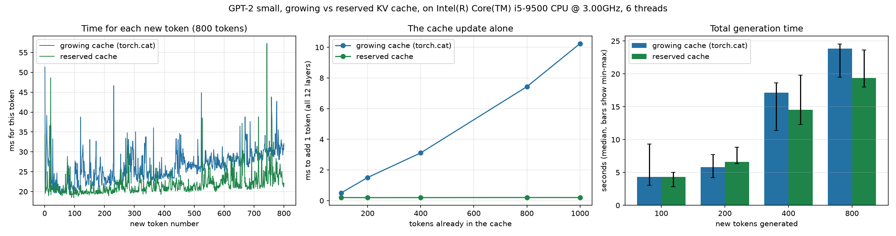

# GPT-2 reserved KV cache: stop copying, start writing in place

> Follow-up to [my first KV cache](../gpt2-kv-cache/). That cache grew with `torch.cat`, which
> copies everything already cached on every step. Here I reserve the cache's memory once and write
> each new token into the next free slot, the way serving engines do, and measure what changes.

**Result:** adding one token to the cache (all 12 layers) took **10.25 ms with the growing cache
but 0.20 ms with the reserved one** when 1,000 tokens were cached: **about 50× less**. The cost
stays flat however long the text gets. Over a whole 800-token answer, the last tokens took
**~24 ms instead of ~31 ms** each, with exactly the same text. The price: **72 MiB reserved from
the first token**.



---

## Contents
1. [The problem with a growing cache](#1-the-problem-with-a-growing-cache)
2. [The fix: reserve once, write in place](#2-the-fix-reserve-once-write-in-place)
3. [What I built](#3-what-i-built)
4. [How I know it is correct](#4-how-i-know-it-is-correct)
5. [How I measured it](#5-how-i-measured-it)
6. [Results](#6-results)
7. [What I learned](#7-what-i-learned)
8. [Problems I hit and how I solved them](#8-problems-i-hit-and-how-i-solved-them)
9. [Limits](#9-limits)
10. [Run it yourself](#10-run-it-yourself)
11. [Check yourself](#11-check-yourself)
12. [Reading and credits](#12-reading-and-credits)

---

## 1. The problem with a growing cache

My first cache added each new token's Keys and Values like this:

```python
k = torch.cat([self.k[layer], k], dim=2)
```

`torch.cat` can't add a row to an existing tensor. It makes a **new, bigger tensor** and copies
everything into it: all the old tokens plus the new one.

| Adding token | What `torch.cat` copies (one layer) |
|---|---|
| 10 | 9 old + 1 new = 10 tokens |
| 100 | 99 old + 1 new = 100 tokens |
| 800 | 799 old + 1 new = 800 tokens |

So the copy **grows with the text**. With 800 tokens cached, one step copies
800 × 73,728 bytes ≈ **56 MiB** across the 12 layers, every step, just to add one token.

Everyday version: a notebook with no spare pages. To add one line, you buy a notebook one page
bigger and rewrite every page you already had.

## 2. The fix: reserve once, write in place

Buy the full notebook once, then write each new line on the next empty page.

```
start:      [ empty | empty | empty | ... | empty ]     1,024 slots reserved (72 MiB)
prefill:    [ t1 t2 ... t14 | empty | ... | empty ]     the prompt goes in
each step:  [ t1 ... t14 t15 | empty | ... | empty ]    write 1 token at position 15. Nothing moves.
```

- One K tensor and one V tensor for all layers, shape `(layers, batch, heads, max_tokens, head_dim)`,
  allocated **once**.
- A write position per layer. A new token's K and V are written at `[pos : pos + 1]`.
- Attention reads `[:pos + 1]`, a **view** into the same memory, not a copy.

**The trade-off:** memory for the longest possible text is taken up front:
1,024 × 73,728 bytes = **72 MiB**, even for a 5-token answer. One user, fine. A server with
hundreds of users would waste most of that memory on empty slots, and that waste is exactly what
**paged** caches (vLLM's PagedAttention) solve: reserve small blocks only as they are needed.

The other reason engines do this: **fixed shapes**. The cache tensors never change size, which is
what tools like `torch.compile` and CUDA graphs need to work well.

## 3. What I built

```
llm-serving-on-cpu/
├── gpt2lab/
│   ├── static_kv_cache.py   the reserved cache: StaticKVCache   ← this experiment
│   ├── kv_cache.py          the first (growing) cache; generate_with_cache() now takes any cache
│   ├── model.py             GPT-2 from scratch: unchanged
│   └── bench.py             the shared benchmark method
└── gpt2-static-kv-cache/
    ├── tests/test_static_kv_cache.py   7 tests
    ├── benchmark/run.py                growing vs reserved, plus the cache update alone
    └── results/                        results.csv, per_token.csv, cache_update.csv, environment.json, chart.png
```

The heart of [`static_kv_cache.py`](../gpt2lab/static_kv_cache.py):

```python
class StaticKVCache:
    def __init__(self, n_layer, n_head, head_dim, max_tokens, batch_size=1, ...):
        shape = (n_layer, batch_size, n_head, max_tokens, head_dim)
        self.k = torch.zeros(shape)          # all the memory, taken now
        self.v = torch.zeros(shape)
        self.pos = [0] * n_layer             # where the next token goes, per layer

    def update(self, layer, k, v):
        start = self.pos[layer]
        end = start + k.shape[2]
        self.k[layer, :, :, start:end] = k   # copy only the NEW token in
        self.v[layer, :, :, start:end] = v
        self.pos[layer] = end
        return self.k[layer, :, :, :end], self.v[layer, :, :, :end]   # views, not copies
```

**`model.py` did not change at all.** The new cache has the same interface as the first one
(`update`, `len`, `nbytes`), so the three "KV cache hooks" in the model work with either cache.
That is the benefit of keeping the cache in its own file behind a small interface.

## 4. How I know it is correct

`uv run pytest` (from this folder) runs 7 tests:

| Test | What it proves |
|---|---|
| Same text (3 prompts) | Reserved cache = growing cache = no cache, token for token |
| Same scores step by step | Prefill + 5 decode steps give the same scores as the growing cache (within 1e-5) |
| Memory reserved up front | 72 MiB (1,024 × 73,728 bytes) before the first token, and never more |
| No copy of old tokens | The storage never moves, and `update()` returns a view into it |
| Full cache | Writing past `max_tokens` raises a clear error |

The benchmark also checks that both caches write exactly the same text at every length; it stops
if they don't.

## 5. How I measured it

Same CPU as before: Intel i5-9500, 6 cores, no GPU, PyTorch 2.15 (CPU), float32, greedy, the same
14-token prompt, 6 threads. Exact details in [`results/environment.json`](results/environment.json).

Two measurements:

1. **The cache update alone:** fill a cache with 100 … 1,000 tokens, then time adding one token
   to all 12 layers, 20 times; 15 repeats, median. No model around it, so very little noise.
   This measures exactly the part that changed.
2. **Whole generation:** 100 / 200 / 400 / 800 new tokens, 1 warm-up run thrown away, 3 timed
   runs, median and min-max. The two caches **take turns** (growing, reserved, growing, …), so a
   slow moment on the machine hits both equally.

Why both? See [Problems](#8-problems-i-hit-and-how-i-solved-them): on a normal desktop, whole-run
times vary by ±20%, which is bigger than the gain itself.

## 6. Results

### The cache update alone (clean)

| Tokens already cached | Growing (`torch.cat`) | Reserved | Reserved is |
|---|---|---|---|
| 100 | 0.50 ms | 0.20 ms | 2.5× cheaper |
| 200 | 1.51 ms | 0.20 ms | 7.7× cheaper |
| 400 | 3.11 ms | 0.20 ms | 16× cheaper |
| 800 | 7.44 ms | 0.20 ms | 36× cheaper |
| 1,000 | 10.25 ms | 0.20 ms | **50× cheaper** |

The growing cache's cost rises in a straight line with the text; the reserved cache stays flat at
about 0.2 ms (the cost of writing one token). At 800 cached tokens the growing cache copies about
56 MiB per step in 7.4 ms, roughly 8 GB/s, which is a plain memory copy on this machine.

### Time per new token (800-token answer, median of 3 runs)

| New token number | Growing | Reserved |
|---|---|---|
| 1–50 | 23.3 ms | 20.7 ms |
| 400–450 | 24.4 ms | 21.2 ms |
| 750–800 | **30.6 ms** | **24.3 ms** |

The left chart shows it: the blue line (growing) slopes upward as the copy grows; the green line
(reserved) stays much flatter. By the end, the copy is about a quarter of each step's time.

### Whole generation (noisy; read with the ranges)

| New tokens | Growing: median (min–max) | Reserved: median (min–max) | Memory at the end |
|---|---|---|---|
| 100 | 4.32 s (3.07–9.34) | 4.31 s (2.84–4.99) | 8.0 MiB vs 72 MiB |
| 200 | 5.79 s (4.22–7.72) | 6.62 s (6.35–8.85) | 15.0 MiB vs 72 MiB |
| 400 | 17.17 s (11.40–18.62) | 14.56 s (12.28–19.78) | 29.0 MiB vs 72 MiB |
| 800 | 23.86 s (19.51–24.56) | 19.36 s (18.00–23.61) | 57.2 MiB vs 72 MiB |

- **Short answers (100–200 tokens): no real difference.** There is little to copy, and the
  ranges overlap completely.
- **800 tokens: reserved was faster, about 19% at the median.** The ranges still overlap, so this
  single run doesn't prove it alone. But I ran the full benchmark four times today (three earlier
  runs were thrown away as too noisy), and the reserved cache had the lower median at 800 tokens
  in all four.
- **Memory:** the growing cache uses only what it needs (57 MiB at 813 tokens). The reserved one
  takes 72 MiB from the start, the trade-off from section 2.
- Absolute times differ from my first KV cache experiment (20 Nov) because the machine was in a
  different state that day; same library versions. Only compare numbers within one run.

## 7. What I learned

1. **`torch.cat` in a loop is a hidden O(n²).** Each step copies everything so far, so the total
   copying over n tokens grows with n². It doesn't show for short texts and grows for long ones.
2. **Reserving memory is a trade: speed and fixed shapes for wasted space.** That waste is the
   reason paged caches exist, which is the next step for this cache.
3. **A small interface pays off.** The model needed zero changes to use a completely different
   cache, because both have the same `update` / `len` / `nbytes`.
4. **Measure the part you changed.** The whole-run gain (~10–20%) was smaller than the desktop's
   run-to-run noise (±20%). Timing only the cache update gave a clean 50× answer; interleaving
   the runs made the whole-run comparison fair.
5. **On this CPU, the model's maths still dominates.** Even with no copying, each token costs
   ~20 ms of matrix work. Copying is a growing tax on top, not the main cost.

## 8. Problems I hit and how I solved them

| Problem | What I saw | How I solved it |
|---|---|---|
| Noisy results | 400 tokens took longer than 800 in one run; the same code varied from 20.5 s to 31.7 s | Interleaved the two caches run by run, and added the cache-update micro-benchmark |
| Busy CPU at the start | CPU load 5.0 when the run began, right after the tests | Started the final run only once the 1-minute load was below 3; disturbed runs were thrown away |
| "Load at end" always high | ~8 after every run | Not a problem: the benchmark itself keeps 6 cores busy. Only the load at the start says how quiet the machine was |
| Different speed from 20 Nov | Both caches ~2× faster than the first experiment's cache | Checked: same torch and transformers versions. It's the machine's state on the day, so I only compare within one run |

## 9. Limits

- **One machine, one desktop with other apps open.** The whole-run numbers are noisy; the
  cache-update numbers are the reliable ones.
- **Batch size 1, one request.** A server reserving 72 MiB per user would waste a lot; that is
  what paging fixes.
- **No `torch.compile` yet.** Fixed shapes are one of the reasons to reserve, but I haven't
  measured compiling the model here.
- **Attention reads a slice of a bigger tensor** (`[:pos + 1]`), which is not laid out
  contiguously. That didn't cost anything visible here, but kernels on other hardware may care.

## 10. Run it yourself

From the repo root, once: `uv sync`. Then from this folder:

```bash
uv run pytest                        # 7 correctness tests
uv run python benchmark/run.py       # ~7 minutes on a 6-core CPU; writes results/
```

Use the reserved cache in your own code:

```python
from transformers import GPT2TokenizerFast
from gpt2lab.kv_cache import generate_with_cache
from gpt2lab.load_weights import load_gpt2
from gpt2lab.static_kv_cache import StaticKVCache

tokenizer = GPT2TokenizerFast.from_pretrained("gpt2")
model = load_gpt2()
idx = tokenizer("The cat sat on the", return_tensors="pt").input_ids
out = generate_with_cache(model, idx, 30, cache=StaticKVCache.for_model(model))
print(tokenizer.decode(out[0]))
```

## 11. Check yourself

1. Adding token 400 to a `torch.cat` cache copies how much compared with adding token 10?
2. How much memory does a reserved cache for 1,024 tokens take before the first token arrives?
3. Why does the reserved cache give exactly the same text?
4. Why did the whole-run timing fail to prove the gain on its own, and what fixed that?
5. What problem does reserving memory create, and what kind of cache solves it?

<details><summary>Answers</summary>

1. About 40× more: the copy grows with the cache (400 tokens vs 10).
2. All of it: 1,024 × 73,728 bytes = 72 MiB.
3. It changes where K and V are stored, not what they are. The maths is identical.
4. The gain (~10–20%) was smaller than the run-to-run noise (±20%). Timing only the cache update,
   and taking turns between the two caches, fixed it.
5. Memory reserved for the longest text sits empty for short answers. Paged caches (vLLM)
   hand out small blocks only when needed.

</details>

## 12. Reading and credits

- Hugging Face Transformers, "KV cache strategies" docs: `DynamicCache` (growing) vs `StaticCache`
  (reserved), and why static shapes matter for `torch.compile`.
- Kwon et al., *"Efficient Memory Management for Large Language Model Serving with
  PagedAttention"* (vLLM), SOSP 2023, arXiv 2309.06180: the waste a reserved cache leaves, and
  the fix.
- Built on [my first KV cache](../gpt2-kv-cache/) and the shared [`gpt2lab`](../gpt2lab/) package.

## Licence
MIT, see [LICENSE](../LICENSE).
