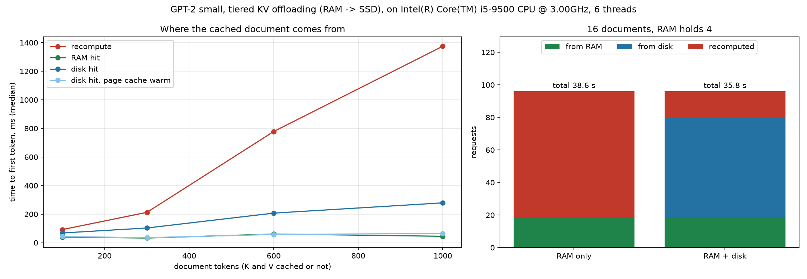

# GPT-2 tiered KV offloading: when RAM is full, move the cache to disk instead of deleting it

> Eighth and last experiment in the caching series. The [prefix cache](../gpt2-prefix-cache/)
> keeps a few prompts' Keys and Values in RAM and **deletes** the oldest when it is full; if that
> prompt comes back, it is recomputed from scratch. Here, pushed-out entries are **saved to the
> SSD** instead, and read back when needed.

**Result:** reading a cached document back from the SSD gave the first token **4.9× sooner than
recomputing it** at 1,000 tokens (279 ms vs 1,375 ms), 3.8× at 600 and 2.1× at 300; even at 100
tokens it was slightly faster. RAM is still best (~40 ms). Two honest catches:
- a naive test reads the "disk" file from the operating system's memory and looks **4.3× better**
  than the real disk;
- in a busy workload the gain shrank to **7%**, because each save to disk (~150 ms) happened
  inside a request.



---

## Contents
1. [The idea](#1-the-idea)
2. [What I built](#2-what-i-built)
3. [How I know it is correct](#3-how-i-know-it-is-correct)
4. [How I measured it](#4-how-i-measured-it)
5. [Results](#5-results)
6. [What I learned](#6-what-i-learned)
7. [Decisions and trade-offs](#7-decisions-and-trade-offs)
8. [Problems I hit and what didn't work](#8-problems-i-hit-and-what-didnt-work)
9. [Limits](#9-limits)
10. [Run it yourself](#10-run-it-yourself)
11. [Check yourself](#11-check-yourself)
12. [Reading and credits](#12-reading-and-credits)

---

## 1. The idea

Cached K and V take a lot of room: 73,728 bytes per token for GPT-2 small, so a 1,000-token
document is 70 MiB. RAM fills up quickly. When it does, there are three choices for an old entry:

| Choice | Next time it's needed |
|---|---|
| Delete it | Recompute: run the model over the whole document again |
| **Move it to disk** | Read the file back |
| Keep it in RAM | Instant, but RAM is limited |

Tiered offloading uses all three: a small **RAM tier** for hot entries, a bigger **disk tier**
for warm ones, and deletion only when the disk tier is full too.

```
lookup:  RAM tier ──miss──► disk tier ──miss──► recompute
            ▲                  │ hit: load the file back into RAM
            └──────────────────┘ (and push the oldest RAM entry down to disk)
```

Whether it's worth it is a race: **reading N MiB from disk** vs **recomputing N tokens**. This is
what LMCache and NVIDIA's KV-block offloading do on big servers (GPU → CPU RAM → disk).

Everyday version: a desk (RAM), a filing cabinet (disk) and the bin. Moving an old file to the
cabinet beats throwing it away, if fetching it from the cabinet is quicker than writing it again.

## 2. What I built

```
llm-serving-on-cpu/
├── gpt2lab/tiered_prefix_store.py    TieredPrefixStore   ← this experiment
├── gpt2lab/prefix_cache.py           + an _evict() hook: what happens to an entry pushed out
└── gpt2-tiered-kv-cache/
    ├── tests/test_tiered_prefix_store.py   6 tests
    ├── benchmark/run.py                    4 situations x 4 lengths, and a 96-request workload
    └── results/                            lengths.csv, workload.csv, environment.json, chart.png
```

- **`PrefixStore`** got one small hook: `_evict(key, value)`, called for every entry pushed out of
  RAM. The plain store does nothing (the entry is dropped).
- **`TieredPrefixStore`** extends the prefix store and overrides `_evict()` to **save the entry to a
  file** (`torch.save` of all layers' K and V). `lookup()` checks RAM, then disk; a disk hit loads
  the file back into RAM, which may push another entry down. The disk tier has its own limit and
  deletes its oldest file when full.
- It plugs into `prefill_with_prefix_cache()` unchanged, so it works exactly like the prefix cache.

**Making disk timing honest:** Linux keeps recently written files in memory (the page cache). A
file written a moment ago is read back from RAM, not the disk. After each save, the store flushes
the file to disk (`fsync`) and tells Linux to drop it from memory (`posix_fadvise DONTNEED`, no root
needed), so later reads really come from the SSD.

## 3. How I know it is correct

`uv run pytest` (from this folder) runs 6 tests:

| Test | What it proves |
|---|---|
| Evicted entry goes to disk and comes back identical | Every K and V tensor is bit-for-bit the same after the round trip; loading it pushes the other entry down |
| RAM hit preferred, no duplicates | A RAM entry is used before disk; adding the same prompt twice keeps one copy |
| Disk tier limit | The oldest file is deleted when the disk tier is full; `clear_disk()` removes everything |
| Look-only lookup | Checking doesn't load a file back |
| Same text after a round trip through disk | Same last-token scores (within 1e-4) and same 15 tokens as a plain prefill |
| Plain prefix store still drops | The refactor didn't change the original store |

The prefix-cache and routing tests also still pass after the `_evict()` refactor.

## 4. How I measured it

Intel i5-9500, 6 threads, float32, SATA SSD (512 GB), CPU load 2.03 at the start, no browser.
Details in [`results/environment.json`](results/environment.json).

**Where the files go:** on this machine `/tmp` is **tmpfs, which lives in RAM**, so files written
there never touch the disk. The benchmark writes to a folder on the SSD inside this experiment, and
deletes it at the end.

1. **Four situations, four lengths** (documents of 100 / 300 / 600 / 1,000 tokens from WikiText-2,
   plus a question). Time to first token when the document's K and V are:
   - **recomputed**: nothing cached;
   - **RAM hit**: in RAM;
   - **disk hit**: on the SSD, dropped from the page cache;
   - **disk hit, page cache warm**: the same file, still in memory (what a naive test would measure).

   The timed request only reads; the **save** time is measured separately. Warm-up, 7 timed runs,
   median and min–max, taking turns.
2. **A workload:** 16 documents (500 tokens) × 6 questions = 96 requests in random order. RAM holds
   4 documents. RAM-only store vs RAM + disk (16 documents). Here saving happens **inside** the
   request that pushes an entry out, as it does in this simple design, and is counted.

## 5. Results

### Time to first token by where the document comes from (median of 7)

| Document | File size | Recompute | RAM hit | **Disk hit** | Disk, page cache warm | Save to disk |
|---|---|---|---|---|---|---|
| 100 tokens | 7.0 MiB | 92 ms | 40 ms | **68 ms (1.3×)** | 43 ms | 89 ms |
| 300 tokens | 21.1 MiB | 213 ms | 33 ms | **103 ms (2.1×)** | 35 ms | 100 ms |
| 600 tokens | 42.2 MiB | 778 ms | 61 ms | **207 ms (3.8×)** | 58 ms | 165 ms |
| 1,000 tokens | 70.3 MiB | 1,375 ms | 45 ms | **279 ms (4.9×)** | 65 ms | 238 ms |

*(×) = how much sooner than recomputing. Min–max ranges are in `lengths.csv`.*

- Recompute grows faster than linearly with length (attention over more tokens); a disk read grows
  linearly with the file size. So **the longer the document, the more disk wins**.
- At 1,000 tokens, the disk hit is a ~235 ms SSD read (70 MiB at ~310 MB/s, measured separately)
  plus ~45 ms of compute.
- **The page-cache trap:** reading the same file while it's still in memory takes 65 ms, 4.3× better
  than the real disk. A test without `fsync` + `DONTNEED` would report that.

### Workload (96 requests, 16 documents, RAM holds 4)

| Store | From RAM | From disk | Recomputed | Total time to first token |
|---|---|---|---|---|
| RAM only | 19 | 0 | 77 | 38.6 s |
| **RAM + disk** | 19 | **61** | 16 | **35.8 s (7% less)** |

61 of the 77 recomputes became disk reads, but the total only fell 7%: every eviction **writes**
a ~35 MiB file (~150 ms) inside a request, and that eats most of what the faster reads save.

## 6. What I learned

1. **Disk can beat recomputing, and the margin grows with length.** 4.9× at 1,000 tokens on a
   plain SATA SSD.
2. **Measure the real disk.** Linux's page cache made the "disk" look 4.3× faster than it is, and
   `/tmp` on this machine isn't a disk at all.
3. **Writes cost as much as reads here.** A synchronous save (~150–240 ms) cancelled most of the
   gain in a busy workload. Real systems write in the background, off the request path; that's the
   obvious next step.
4. **Read the benchmark's own cost.** My first version timed extra saves inside the "disk hit" and
   made disk look slower than recomputing below 450 tokens (see Problems).
5. **Tiers are a ladder, not a switch.** RAM ~40 ms, disk 70–280 ms, recompute 90–1,400 ms. Each
   tier pays when the one above is full and the one below is slower.

## 7. Decisions and trade-offs

| Decision | Why | Cost |
|---|---|---|
| `_evict()` hook in `PrefixStore`, overridden by the tiered store | One clean extension point; the plain store is unchanged | A small refactor of experiment 4's code |
| One file per entry, `torch.save` | Simple; measured as fast as a raw read (~310 MB/s both) | File-system overhead per entry |
| `fsync` + `posix_fadvise(DONTNEED)` after each save | Honest disk reads | Saves are slower (they wait for the disk) |
| Synchronous saves | Simple and easy to measure | Saves sit on the request path (the 7% workload result) |
| float32 on disk | Identical round trip | int8 (experiment 3) would make files 3.8× smaller and reads faster |

## 8. Problems I hit and what didn't work

| Problem | What I saw | How I solved it |
|---|---|---|
| `/tmp` is RAM | `findmnt` showed `/tmp` is tmpfs | Offload files go to a folder on the SSD (git-ignored, deleted after the run) |
| Page cache hides the disk | A just-written file is read from memory | `fsync` + `posix_fadvise(DONTNEED)` after every save; the warm case is measured separately to show the difference |
| Disk hits looked slow | First run: 580 ms at 1,000 tokens, slower than recompute below ~450 tokens, and only ~130 MB/s | Measured the SSD alone: ~310 MB/s, same with `torch.load` and a raw read. The extra time was **two saves inside the timed request** (the RAM tier held 1 entry, so loading one entry pushed another out). Fixed the setup so the timed request only reads: 580 → 279 ms |
| A monkey-patch | My first version patched `PrefixStore.add` at import time to intercept evictions | Replaced it with an `_evict()` method the tiered store overrides |

## 9. Limits

- One SATA SSD; NVMe drives are several times faster, a hard disk far slower.
- Saves are synchronous; a background writer would remove them from the request path.
- float32 files; compressing with int8 (experiment 3) was not combined here.
- One process: no sharing of the disk tier between workers or machines (LMCache does that).

## 10. Run it yourself

From the repo root, once: `uv sync`. Then from this folder:

```bash
uv run pytest                                  # 6 tests
uv run python benchmark/run.py                 # ~8 minutes; writes results/
uv run python benchmark/run.py --chart-only    # redraw chart.png
```

```python
from gpt2lab.prefix_cache import prefill_with_prefix_cache
from gpt2lab.tiered_prefix_store import TieredPrefixStore

store = TieredPrefixStore(ram_entries=4, disk_dir="kv_offload", disk_entries=64)   # on a real disk, not /tmp
logits, cache, reused = prefill_with_prefix_cache(model, prompt_ids, store, store_upto=doc_len)
```

## 11. Check yourself

1. When does reading K and V from disk beat recomputing them, and why does the gap grow with length?
2. What is the page cache, and why would it make a disk benchmark lie?
3. Why did the workload only improve 7% when 61 recomputes became disk reads?
4. Why was `/tmp` the wrong place for the offload files on this machine?
5. What would make the disk tier faster without a faster disk?

<details><summary>Answers</summary>

1. When the file read is quicker than the model pass. Recompute grows faster than linearly
   (attention over more tokens); the read grows linearly with file size.
2. Linux keeps recently used file data in RAM. A file read right after writing comes from memory,
   not the disk.
3. Every eviction wrote a ~35 MiB file inside a request (~150 ms), cancelling most of the time
   saved by reading instead of recomputing.
4. `/tmp` is tmpfs here, which is stored in RAM.
5. Background (asynchronous) writes, and smaller files: int8 K and V would be 3.8× smaller.

</details>

## 12. Reading and credits

- LMCache project documentation (KV cache offloading to CPU memory and disk).
- NVIDIA Dynamo documentation, "KV block manager" (GPU → CPU → storage tiers).
- Linux `posix_fadvise(2)` and `fsync(2)` manual pages.
- Built on [prefix caching](../gpt2-prefix-cache/) and the shared [`gpt2lab`](../gpt2lab/) package.

## Licence
MIT, see [LICENSE](../LICENSE).
