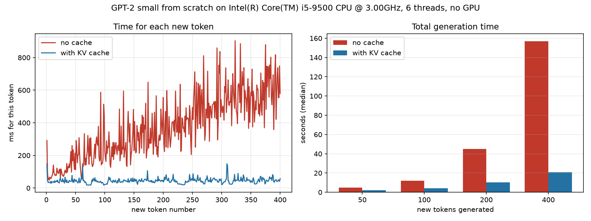
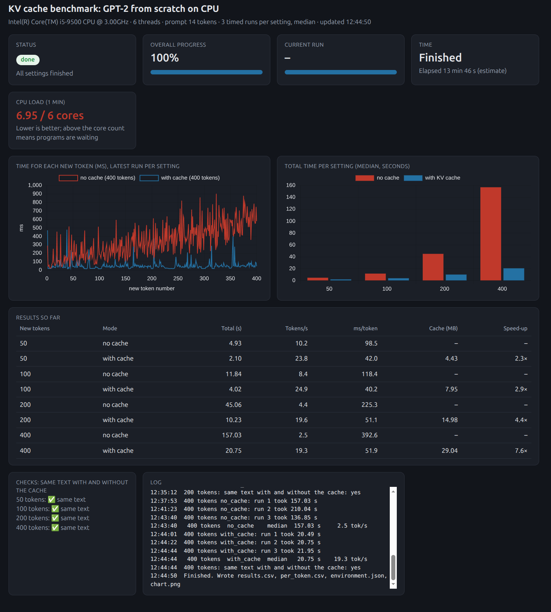

# KV cache from scratch

> A learning project: I wanted to really understand the **KV cache**, the trick that makes every
> LLM write text fast. So I wrote GPT-2 myself in plain PyTorch, loaded OpenAI's real weights into
> it, built my own KV cache inside it, and measured the difference on a normal CPU with no GPU.

**Result:** with my KV cache, writing 400 tokens took **20.75 s instead of 157.03 s (7.6× faster)**,
with exactly the same text. The cache cost **72 KB of memory per token**.



---

## Contents
1. [Why I built this](#1-why-i-built-this)
2. [How an LLM writes text](#2-how-an-llm-writes-text)
3. [Attention: Q, K and V](#3-attention-q-k-and-v)
4. [The waste, and the KV cache that fixes it](#4-the-waste-and-the-kv-cache-that-fixes-it)
5. [What the cache costs: memory](#5-what-the-cache-costs-memory)
6. [What I built](#6-what-i-built)
7. [How I know it is correct](#7-how-i-know-it-is-correct)
8. [How I measured it](#8-how-i-measured-it)
9. [Results](#9-results)
10. [What I learned](#10-what-i-learned)
11. [Problems I hit and how I solved them](#11-problems-i-hit-and-how-i-solved-them)
12. [Limits](#12-limits)
13. [Run it yourself](#13-run-it-yourself)
14. [Check yourself](#14-check-yourself)
15. [Reading and credits](#15-reading-and-credits)

---

## 1. Why I built this
- Every chat assistant uses a KV cache. It decides how fast answers appear, how much memory a
  conversation needs, and how many users one machine can serve.
- Tools like vLLM, prefix caching, speculative decoding and grouped-query attention (GQA) are all
  built on top of it. I could not understand them properly without understanding the plain cache.
- Reading about it was not enough, so I **built it and measured it**.

**What is mine and what is borrowed:**

| Part | Who made it |
|---|---|
| The model code: embeddings, attention, MLP, 12 blocks, output layer | Me (`model.py`, plain PyTorch, no Hugging Face model code) |
| The KV cache and the generation loop | Me (`model.py`) |
| The tests, the benchmark, the live dashboard | Me |
| The trained weights (124 million numbers) | OpenAI's GPT-2 small, downloaded through Hugging Face |
| Hugging Face's own GPT-2 | Used only in the tests, as the answer key |

Training GPT-2 myself would need billions of words and GPUs for days. The KV cache is about
**running** a model, not training it, so borrowing the trained weights is fine here.

---

## 2. How an LLM writes text
1. Text is split into **tokens** (word pieces), each with a number.
   `"The cat sat on the"` → `[464, 3797, 3332, 319, 262]`
2. The model reads all the tokens so far and gives a score to **every** possible next token
   (50,257 of them). For `"The cat sat on the"`, GPT-2's top guesses are:

   | Next token | Chance |
   |---|---|
   | floor | 7.6% |
   | bed | 6.5% |
   | couch | 5.4% |

3. Pick one (here always the top one: **greedy** decoding), add it to the text, and repeat.

```
step 1: read 5 tokens → " floor"
step 2: read 6 tokens → ","
step 3: read 7 tokens → " and"
step 4: read 8 tokens → " the"
step 5: read 9 tokens → " cat"
```

A 400-token answer means 400 rounds of this loop.

---

## 3. Attention: Q, K and V
Inside each of GPT-2's 12 layers, every token makes three vectors of 64 numbers (per head; there
are 12 heads):

| Vector | Plain meaning | Library comparison |
|---|---|---|
| **Q**, Query | "What am I looking for?" | Your search question |
| **K**, Key | "What do I contain?" | The label on each book's spine |
| **V**, Value | "What do I pass on?" | The book's content |

To decide what to pay attention to, a token compares its **Q** with the **K** of every earlier
token. The match scores become weights, and the token takes a weighted mix of their **V**s:

```
attention = softmax(Q · Kᵀ / √64) · V
```

A **causal mask** stops a token from looking at tokens after it (it cannot see the future).

---

## 4. The waste, and the KV cache that fixes it
**Two facts make the cache possible:**
- Once a token has been processed, **its K and V never change**. Later tokens cannot change the past.
- Only the **newest** token needs a Q, because only it is asking a question.

**Without a cache**, step 400 re-reads all ~414 tokens through all 12 layers, recomputing K and V
that were already computed in step 399. Like re-reading your whole notebook before writing each
new word.

**With a cache**, we keep every layer's K and V. Each step:
1. compute Q, K, V **for the 1 new token only**
2. add its K and V to the cache
3. attend over everything in the cache

Like keeping your notes and only adding the newest line.

```
                 WITHOUT cache                         WITH cache
step 1   [The cat sat on the] → model        [The cat sat on the] → model   (prefill: fill cache)
step 2   [The cat sat on the floor] → model                    [floor] → model + cache
step 3   [The cat sat on the floor ,] → model                      [,] → model + cache
...      input keeps growing                     input is always 1 token
```

This splits generation into two phases:
- **Prefill:** the whole prompt goes in at once and fills the cache. Lots of maths.
- **Decode:** one token per step, reading the cache. Limited by how fast memory can be read.

---

## 5. What the cache costs: memory
For every token, every layer stores one K and one V:

```
2 (K and V) × 12 layers × 12 heads × 64 numbers × 4 bytes (float32) = 73,728 bytes ≈ 72 KB per token
```

| Tokens in cache | Size |
|---|---|
| 100 | ~7 MB |
| 400 | ~28 MB |
| 1,024 (GPT-2's limit) | ~72 MB |

Small for GPT-2. For a modern 8-billion-parameter model it is about **128 KB per token, or ~1 GB
for one 8,000-token conversation**. That is why serving systems care so much about cache memory
(PagedAttention, GQA, cache quantization).

My measured cache matched the formula exactly (a test checks it).

---

## 6. What I built

| File | What it does |
|---|---|
| [`model.py`](model.py) | GPT-2 small from scratch, with the KV cache |
| [`load_weights.py`](load_weights.py) | Copies OpenAI's weights into my model |
| [`test_gpt2.py`](test_gpt2.py) | 8 correctness tests (pytest) |
| [`benchmark.py`](benchmark.py) | Times generation with and without the cache, saves results and the chart |
| [`dashboard/`](dashboard/) | A local live page to watch the benchmark while it runs |
| `results.csv`, `per_token.csv`, `environment.json`, `chart.png` | My numbers and the machine they came from |

### The model
```
token ids
  → token embedding + position embedding      (768 numbers per token)
  → 12 × [ LayerNorm → attention → add back
           LayerNorm → MLP (768 → 3072 → 768) → add back ]
  → final LayerNorm
  → output layer (shares weights with the token embedding)
  → a score for each of the 50,257 tokens
```

**Loading OpenAI's weights:** my layer names match Hugging Face's one to one. One catch: Hugging
Face stores four of GPT-2's layers as `Conv1D`, with weights shaped `(in, out)`, while PyTorch's
`nn.Linear` expects `(out, in)`. So those four are transposed when loading (still true in
transformers 5.23).

### The cache: the important part
```python
class KVCache:
    def update(self, layer, k, v):
        """Append the new tokens' K and V, return K and V for ALL tokens so far."""
        if self.k[layer] is not None:
            k = torch.cat([self.k[layer], k], dim=2)   # dim 2 = the "tokens" dimension
            v = torch.cat([self.v[layer], v], dim=2)
        self.k[layer], self.v[layer] = k, v
        return k, v
```

Inside attention, only the new tokens come in; the cache supplies the rest:
```python
q, k, v = self.c_attn(x).split(C, dim=2)        # x = only the NEW tokens
...
k, v = cache.update(self.layer, k, v)           # now K, V cover every token so far
past = k.shape[2] - T                           # how many tokens were already cached
scores = (q @ k.transpose(-2, -1)) / math.sqrt(self.head_dim)
```

And positions must continue after the cached tokens, not restart at 0:
```python
pos = torch.arange(past, past + T)
```

### A bug I hit (and what it taught me)
My first version asked the cache "how many tokens do you hold?" using **layer 0's** cache. But
layer 0 adds the new tokens before layer 1 runs, so layer 1 thought the new tokens were already
"past". The shapes did not fit and it crashed:
```
The size of tensor a (10) must match the size of tensor b (5)
```
**Fix:** each layer counts from **its own** K (`past = k.shape[2] - T`). The test caught it
immediately, which is why I wrote the tests before the benchmark.

---

## 7. How I know it is correct
`uv run pytest kv-cache-from-scratch` runs 8 tests:

| Test | What it proves |
|---|---|
| Matches Hugging Face (3 prompts) | My GPT-2's output scores are within 0.0001 of Hugging Face's GPT-2 (largest gap 9.5e-05) |
| Same text with and without the cache (3 prompts, 30 tokens) | The cache does not change the output |
| One cached step equals a full recompute | The cache maths is exact |
| Cache size = 73,728 bytes per token | The memory formula holds |

The benchmark also checks for identical text at every length it measures.

With OpenAI's weights, my model writes: *"The cat sat on the floor, and the cat was still asleep."*

---

## 8. How I measured it
- **Machine:** Intel i5-9500 (6 cores), no GPU, PyTorch 2.15 (CPU), Python 3.12, 6 threads
- **Model:** my GPT-2 small, float32, greedy decoding, one request at a time
- **Prompt:** "In a small village by the sea, there lived an old fisherman who" (14 tokens)
- **Settings:** 50, 100, 200 and 400 new tokens, with and without the cache
- **Method:** 1 warm-up run (not counted), then 3 timed runs per setting; I report the **median**
- **Timed:** only the model passes, not loading, tokenising or printing
- Everything about the run is saved in [`environment.json`](environment.json)

I also built a small **live dashboard** to watch the benchmark as it ran: progress, time left, CPU
load, a live per-token chart, results and the same-text checks.



---

## 9. Results

| New tokens | No cache | With KV cache | Speed-up | Cache memory |
|---|---|---|---|---|
| 50 | 4.93 s | 2.10 s | **2.3×** | 4.43 MB |
| 100 | 11.84 s | 4.02 s | **2.9×** | 7.95 MB |
| 200 | 45.06 s | 10.23 s | **4.4×** | 14.98 MB |
| 400 | 157.03 s | 20.75 s | **7.6×** | 29.04 MB |

Median of 3 runs. Same text with and without the cache at every length.

**Time per token** (median by position, from `per_token.csv`):
- **No cache:** grows as the text grows, from about 100 ms early on to about 600 ms near token 400.
- **With cache:** stays about 20–60 ms the whole way (median about 40 ms, a few noise spikes).

---

## 10. What I learned
1. **The cache's benefit grows with length.** 2.3× at 50 tokens, 7.6× at 400. Without a cache the
   work per token keeps growing; with it, the work per token stays about the same.
2. **Even with the cache, a token still costs ~40 ms. Why?** To make one token, the CPU must still
   read all ~500 MB of weights from memory. 500 MB in ~40 ms is roughly 12 GB/s, close to what
   normal desktop memory can deliver. So decode is limited by **memory speed, not maths**.
   (A rough estimate, not a separate measurement.) This is the "decode is memory-bound" idea.
3. **The output does not change.** The cache only removes repeated work. Same weights, same text.
4. **Memory grows with every token.** Exactly 72 KB per token for GPT-2 small.
5. **Benchmarks on a busy PC lie.** My first run was disturbed by other programs: its cached
   400-token run came out faster than its 200-token run, which cannot be right, and it suggested a
   17× speed-up. I threw it away and re-ran. Even the clean run varied: the three no-cache
   400-token runs took 157.03 s, 210.04 s and 136.85 s. That is why I report the median.
6. **Tests first pays off.** The layer-0 bug was caught in seconds, not hidden inside a benchmark.

---

## 11. Problems I hit and how I solved them

| Problem | Fix |
|---|---|
| OpenAI's weights did not fit my layers: Hugging Face stores four of them as `Conv1D`, shaped `(in, out)`, but `nn.Linear` expects `(out, in)` | Transpose those four weights when loading; the loader stops with a clear error on any wrong name or shape |
| **The main bug:** with the cache on, it crashed with `size of tensor a (10) must match ... b (5)` | Each layer was reading **layer 0's** cache length, which already included this step's new tokens. Now each layer counts from its own K: `past = k.shape[2] - T` |
| The first benchmark gave impossible numbers (400 cached tokens faster than 200) because other programs were using the CPU | Threw the run away and re-ran on a quieter machine: **7.6×**, not the 17× the noisy run suggested |
| Repeats varied a lot (400 tokens without cache: 136.85 s to 210.04 s) | Report the **median** of 3 runs and save the machine's load with the results |

---

## 12. Limits
- One small model (GPT-2 small, 124M), float32, one prompt, one request at a time, greedy decoding.
- A desktop CPU with other programs running (CPU load 2.16 at the start, 8.72 at the end); the
  red line is spiky because of that.
- My cache grows with `torch.cat`, which copies the whole cache every step. Real engines reserve the
  memory once and fill it in place. A possible next step.
- My attention is written out by hand for learning, not tuned for speed.
- These numbers describe this setup only. GPU servers and bigger models will look different.

---

## 13. Run it yourself
Needs [uv](https://docs.astral.sh/uv/). Downloads CPU-only PyTorch and the GPT-2 weights (~500 MB)
on first run.

```bash
git clone https://github.com/2sandy-glitch/llm-serving-on-cpu.git
cd llm-serving-on-cpu
uv sync                                                   # Python 3.12 + libraries

uv run pytest kv-cache-from-scratch                       # 8 correctness tests
uv run python kv-cache-from-scratch/benchmark.py          # ~15 minutes on a 6-core CPU

# optional, in a second terminal: watch it live at http://localhost:8765
uv run python kv-cache-from-scratch/dashboard/serve.py
```

Try the model in Python:
```python
from transformers import GPT2TokenizerFast
from load_weights import load_gpt2          # run from inside kv-cache-from-scratch/

tok = GPT2TokenizerFast.from_pretrained("gpt2")
model = load_gpt2()
idx = tok("The cat sat on the", return_tensors="pt").input_ids
print(tok.decode(model.generate(idx, 20, use_cache=True)[0]))
```

---

## 14. Check yourself
1. What do Q, K and V mean, in plain words?
2. Why can K and V be cached, but not Q?
3. What happens to speed and memory as the text grows, with and without a cache?
4. Work out the cache size per token for a model with 32 layers, 8 KV heads, head size 128, 2 bytes per number.
5. What are prefill and decode? Which is limited by maths and which by memory speed?
6. Why does the cache not change the generated text?
7. Why do grouped-query attention (GQA) and PagedAttention exist?

<details>
<summary>Short answers</summary>

1. Q: what a token is looking for. K: what a token contains. V: what a token passes on.
2. Earlier tokens' K and V never change and every later token needs them. Q is only needed for the
   newest token, once.
3. Without: each token gets slower, roughly in proportion to the text length. With: each token
   costs about the same, but memory grows by a fixed amount per token.
4. 2 × 32 × 8 × 128 × 2 = 131,072 bytes = 128 KB per token.
5. Prefill processes the whole prompt at once (maths-heavy). Decode makes one token at a time
   (limited by reading weights and cache from memory).
6. The cached K and V are exactly the numbers that would be recomputed; nothing new is invented.
7. GQA shares K and V across groups of heads, so the cache is smaller. PagedAttention stores the
   cache in small pages so memory is not wasted, letting a server fit more users.
</details>

---

## 15. Reading and credits
**Reading**
- Vaswani et al., ["Attention Is All You Need"](https://arxiv.org/abs/1706.03762) (2017)
- Jay Alammar, ["The Illustrated Transformer"](https://jalammar.github.io/illustrated-transformer/)
- Andrej Karpathy, [nanoGPT](https://github.com/karpathy/nanoGPT)

**Credits**
- The Transformer: Vaswani et al., "Attention Is All You Need" (2017)
- GPT-2 model and weights: OpenAI, Radford et al., "Language Models are Unsupervised Multitask
  Learners" (2019)
- Model code style: Andrej Karpathy's nanoGPT. Its `generate()` re-reads the whole text each step;
  adding a KV cache and measuring it is what this project adds.

---

## Build log
| # | Step | Status |
|---|---|---|
| 1 | Set up: uv, Python 3.12, CPU-only PyTorch | ✅ |
| 2 | Learn: tokens, generation loop, Q/K/V, cache, prefill vs decode | ✅ quiz 3/3 |
| 3 | My own GPT-2, matching Hugging Face | ✅ 3 tests pass |
| 4 | My own KV cache, same text with and without | ✅ 8 tests pass |
| 5 | Measure | ✅ 7.6× faster at 400 tokens |
| 6 | Write up (this README) | ✅ |

## Rules
- Claude writes the code, I review and approve every step.
- Small commits, plain messages, no AI attribution. Nothing pushed without my yes.
- Before measuring, close extra apps so the timings are clean.

## Licence
MIT, see [LICENSE](../LICENSE).
